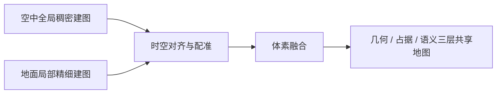

# 第三章 空地协同建图与路径规划技术研究

> **适用范围**：02-技术报告.doc 第三章，替换模板中原有的四个占位小节。
> 3.1—3.4 对应模板原有四个小节，3.5（少视角快速三维重建算法专题）、3.6（验证方法与问题整改）、3.7（小结）为在模板可增加章节处新增的小节。
>
> **编写口径**：本章聚焦问题定义、解决方案与技术方法，**不列实验结果、检测结论与运行数值**；量化要求的达成情况、第三方检测与测评结论与现场验证数据统一在工作报告与相应报告中给出。文中出现的数值均为算法参数、坐标系约定、合同与任务书约定的设计目标或需求条款本身的要求，不是试验测量结果；设计目标只用于界定研究边界，不构成达成结论。凡属设计路线尚未工程落地的内容，仍显式标注【设计路线，未工程落地】，避免把方案写成既成事实。

---

## 3.1 研究目标、技术难点与总体技术路线

### 3.1.1 问题定义与研究目标

变电站设备分布高度不均、空间结构复杂、障碍密集且存在强电磁干扰，单一平台巡检存在固有盲区：无人机视角广、机动快，但受续航、安全距离与高空遮挡限制，难以完成设备底部、狭窄通道与表计近景识读；地面机器狗可进入低矮与遮挡区域，但视野受限、全局定位依赖先验地图，在大范围场景中易出现重复路径与累计漂移。空地协同建图与路径规划的目标，是让两类异构平台共享同一份可计算的环境模型，在同一坐标系下对可由哪类平台到达、通行代价如何衡量、路径失效时如何重构等问题进行统一求解。

将上述笼统的感知盲区分解到方法层面，实际需要同时处理四对结构性矛盾，它们分别落在建图、融合、规划与执行四个环节。第一对矛盾来自观测几何：空中俯视获得设备顶面与站区整体布局，地面前向获得立面、底部与表计近景，同一设备在两个视角下的可见面不同、遮挡关系甚至相反，若把两路观测直接叠加，便会出现同一位置在空中判为障碍、在地面判为可通过的冲突，因而不能靠简单拼接，而要先统一可见性判据再融合。第二对矛盾来自空间基准：空中三维重建与地面二维栅格各自建系，原点、尺度、轴向均不相同，本章约定 X-Z 为水平面、Y 为竖直方向，而常见机器人地图系以 x-y 为水平面，不解决基准与外参问题，所谓共享地图也只是两张图并列，无法在同一坐标系下判定各平台的可达范围。第三对矛盾来自更新节奏：空中全局稠密重建计算量大、适合低频离线完成，地面局部建图则必须随平台运动持续刷新，若要求两者同步完成才允许规划，规划将永远拿不到最新地图，只有按层解耦、让全局层与局部层各按自身频率更新并只同步变化部分，才能兼顾两者。第四对矛盾来自通行判据：带电安全距离、变压器热点、电缆井高落差、积水与临时杂物、表计识读所需的观测位姿等约束，均不体现在自由与障碍的二值占据中，只按几何最短路求解会得到几何可达却不满足作业合规要求的路径，因此语义风险必须进入路径评价函数，而不只是标注在地图上。

与这四对矛盾相伴的还有不确定性沿链路传递的问题。位姿漂移、图像掩码误差与配准残差会沿观测、重建、栅格化、寻路与航点编译各环节逐级放大，若采用端到端黑盒，一旦结果异常便无法判断误差出在哪一层，更严重的是误差可能被一路带到真机执行阶段。因此本章在链路上设置可独立检查的中间产物——标定外参、配准结果、三值栅格、路径航点与执行遥测——任一环节不满足条件即在该环节阻断并回退，使失败可定位、可复现、可整改。这一考虑也直接决定了后文 3.4 节的数据契约设计与 3.6 节的分层验证思路。

基于上述分析，本研究把共享地图定义为满足三个判据的结构化产物，而不是原始点云本身。其一是可对齐，即所有几何元素位于同一世界坐标系，格心与世界坐标之间有确定的换算关系，任一点在不同地图层中的位置可互相校验；其二是可搜索，即地图被组织为自由、障碍与未知三值占据栅格及附加代价层，能被图搜索直接消费，无需在规划时重新解析点云；其三是可注入，即地图派生的事实，例如已知区域比例、路线是否就绪、目标点是否可达，能以确定的键值形式进入决策系统的世界状态，供动作前置条件判定使用。三个判据共同约束了地图的组织形式，由此确定分层增量式共享地图的三层结构：几何层保存三维点云、高斯基元与相机位姿，供配准与可视化使用；占据层保存三值栅格与高度信息，供寻路与避障使用；语义层保存风险标签、代价系数与前瞻约束，供合规判断使用。三层按不同频率更新，既避免全量点云反复传输，也使规划与决策只消费自己需要的那一层，而不必等待整份地图重建完成。

需要说明的是，本研究没有采用把全部观测汇成一份全局点云、再由规划模块按需裁剪这一更为直接的做法。单一全局表示看似简单，却同时带来三处工程困难：空中与地面观测的采集时刻不同，强行合成会使局部变化要么被平滑掉、要么迫使整份地图重算；几何、占据与语义三类信息的更新频率相差很大，绑在同一份数据里只能按最慢的那一层刷新；一旦路径结果异常，也无法判断是重建误差、栅格化误差还是风险标注错误，因为三者已不可分离。分层共享地图以层为边界保留了每类信息的可检查性，代价是要额外维护层间的一致性与版本号，而这部分开销相对固定，可以通过 3.4 节的契约化工具与 3.6 节的逐层验证来覆盖。这一取舍也解释了为什么本章把地图组织方式放在算法细节之前讨论：地图的层次划分实际上决定了后续所有方法的能力边界。

在上述结构下，本章研究的统一求解可形式化为：在共享地图 $\mathcal{M}=(\mathcal{G},\mathcal{O},\mathcal{S})$ 上，为任务点集 $\mathcal{P}$ 求一条满足平台可达性与语义约束的代价最小路径

$$
\pi^{*}=\arg\min_{\pi \in \Pi(\mathcal{P})}\ \sum_{e \in \pi}\big[c_{g}(e)+\lambda_{s}\,c_{s}(e)\big]
$$

其中 $\mathcal{G}/\mathcal{O}/\mathcal{S}$ 分别为几何层、占据层与语义层，$c_g$ 为几何与里程代价，$c_s$ 为语义风险代价，$\lambda_s$ 为风险权重，$\Pi(\mathcal{P})$ 受平台能力、任务优先级与动作前置条件共同约束。这个表达式同时说明了三者的依赖关系：建图产出决定可行域 $\Pi$，语义标注决定 $c_s$，路径规划只是二者之上的一次约束求解，因此三者必须共用同一空间基准，任何一层单独优化都无法得到可用结果；反过来，若规划反馈表明某类路径始终不可行，也应回溯到地图层检查是占据判定还是语义代价设置不当，而不是反复调整寻路参数。

本研究内容对应任务书研究内容（3），需达成四项目标，其中涉及的量化门限均为合同与任务书约定的**设计目标**，用于界定研究边界与求解规模，**不是本章给出的实测结论**，目标达成情况与检测结论统一在工作报告与相应报告中列示。第一项目标是建图精度，即形成空中全局稠密三维地图与地面局部精细地图的分层融合结果，空地协同建图精度满足合同要求 ≤5 cm，并具备增量更新能力；实现上依次完成相机内参与外参标定、空地配准与体素融合，以保证两类地图落在同一空间基准，再以分层增量更新替代全量重建，使局部修正不必重算全局，对应 3.2.2—3.2.4 与 3.5 节的算法内容。第二项目标是计算可行性，即地图结构化后可直接用于路径搜索，地面局部动态建图刷新率 ≥10 Hz；其关键在于把重建产物离线转换为三值占据栅格与代价层，使规划阶段只查表而不解析点云，而全局层低频重建、局部层高频刷新的分层节奏正是满足该目标的结构性前提，对应 3.2.5 与 3.2.6 节。第三项目标是路径可达性，即面向任务点集生成全局最短巡检路径，5 个巡检点范围内路径规划生成时间 ≤30 s、巡检点到达率 ≥90%，并对突发障碍做局部重构；方法上采用分区、排序与逐段寻路三级求解，把多目标组合优化拆成可控规模的子问题，并在栅格层限制搜索空间，局部层则以跟踪与避障算法吸收突发障碍，避免每次扰动都触发全局重算，对应 3.3.1—3.3.3 节。第四项目标是接口贯通性，即地图与路径结果能以统一数据契约输出到决策系统与机器狗执行通道，实现感知、决策、执行与反馈闭环；为此以语义化的工具契约承载地图事实，以统一执行通道抽象隔离真机差异，航点经坐标标定后编译为平台指令，并把执行遥测回写供下一轮判定使用，对应 3.4 全节。四项目标并非彼此独立：建图精度与刷新节奏决定地图是否可信，可信的地图与语义代价决定路径是否可行，而统一数据契约决定可行路径能否真正落到执行，因此后文按建图、规划与闭环的顺序依次展开。

> **口径说明**：目标 3 中5 个巡检点范围内路径规划生成时间 ≤30 s来自合同与第三方测评的约定条件，与需求规格说明书 2.2.2(3) 的全局路径规划计算时间不超过 10 秒测试条件不同，两者不互相替代，也不互相否定；口径差异与现场复核方式见 3.1.5 节。

### 3.1.2 研究边界与验证思路

本章解决的是**方法层面**的三个问题：空地异构数据如何在同一空间基准下融合、融合结果如何转化为可搜索的导航地图、语义风险如何进入路径评价并落到可执行指令。与本章相邻但不在本章展开的内容包括传感器选型与硬件联调（T1 / T3）、缺陷识别与健康评估模型（T6）、轻量大模型部署（T7）以及系统集成与现场验证（T8）。为避免因接口含糊而把相邻任务包的工作误写进本章，边界按三条原则划分：以数据契约为界，本章的输入是已完成标定与时间同步的多模态观测帧，输出是可被决策系统与执行通道消费的地图事实、路径结果与航点指令，传感器驱动、采集硬件与 SDK 联调均不属于本章；以算法职责为界，本章只回答目标位置、通行可行性、路径求取与失效重构，不回答设备是否存在缺陷及其等级，也不决定子任务的平台归属，三类结论通过明确定义的接口传递而不互相隐式依赖；以可验证性为界，每个环节都保留可独立检查的中间产物，可单独复现与比对，不以一次端到端演示代替逐环节验证，避免失败时无法定位到具体层级。

具体到任务包之间的接口，T1 / T3 向本章交付标定参数以及时间同步后的观测帧与位姿，接口形式为数据文件与消息帧，传感器选型、驱动开发与硬件联调明确不在本章；本章（T4）以任务点集和现场采集资料为输入，向下游交付分层共享地图、语义代价层、全局路径、局部重构结果与航点指令，接口形式为算法源码与接口规范。对第四章的 T5 而言，本章提供的是地图派生事实，包括已知区域比例、路线是否就绪、目标点是否可达，以及无人机 / 机器狗 / 协同算力这类物理平台标签，它们以世界状态键值和统一数据契约的形式被消费，而子任务分解、平台分配与动态重调度由第四章负责。T6 的缺陷识别与健康评估为语义代价图层提供热点、异音、高落差等标签来源，本章只做标签到栅格的映射，不承担缺陷判定模型与健康度计算；T8 的系统集成与现场验证消费本章功能演示所需的中间产物与运行记录，集成部署与现场应用结论同样不在本章给出。这样的划分使本章的方法可以脱离具体硬件与具体识别模型独立验证，也使后续某一任务包的实现发生变化时，只需替换接口两侧而不必重写本章算法。

本章的方法还建立在作业前已确认的一组前置条件之上：安全作业许可已生效、平台在线且位姿可用、内外参已完成标定、地图可加载、控制链路可用。这些条件不是可以默认跳过的开关，在决策系统中它们以世界状态字段的形式参与动作前置条件判定，条件不满足时相应动作即被阻断，不允许在条件缺失的情况下继续执行（见 3.4.2）。真机部署时，safety_cleared、battery、uav_online 等字段必须由安全联锁与机载遥测真实写入，不得沿用实验室默认值。本章的验证设计同样以条件可观测、违例可复现为前提，因此故障注入与确定性回放是必要手段，而非附加项；只有把前置条件显式化，仿真通道与真机通道之间的差异才能被逐项定位，而不至于被笼统地归为端到端无法完成。

验证按四个层次组织，表 3-1 给出各层次关注的问题与采用的手段；具体测试结果、检测结论与量化要求的达成情况不在本章列示。四层之外，贯穿全链路的判定依据是三类一致性，它们比单一结果数值更能反映方法本身是否成立。空间一致性要求同一物理点在几何层、占据层与航点指令中的坐标一致，坐标系换算与格心定义可反向验证；逻辑一致性要求地图派生事实与动作前置条件的判定结果一致，尤其要求纯计算型工具的观测必须来自真实计算，不能被执行通道的模板值覆盖；时序一致性要求计划、执行与反馈引用同一地图版本号，避免新地图与旧航点混用造成错配。三类一致性分别对应计算正确、判定正确与所引用数据一致，任意一类被破坏，即使单次端到端演示成功，方法在换场景或换平台后也难以复现。

**表 3-1 验证层次与对应手段**

| 层次 | 关注的问题 | 采用手段 | 对应小节 |
| --- | --- | --- | --- |
| 算法正确性 | 坐标系换算、占据语义、寻路与增量更新是否自洽 | 单元测试与回归用例；与独立导航管线的路径比对 | 3.2.5 / 3.3.1 |
| 接口正确性 | 地图事实能否注入世界状态、真实计算是否被通道覆盖 | 感知工具与执行通道的契约测试 | 3.4.1 / 3.4.2 |
| 时序与容错 | 超时、可取消、遥测回写、急停与故障注入下的行为 | 硬件在环仿真与确定性录播回放 | 3.4.3 / 3.6.2 |
| 工程可用性 | 现场环境下的建图质量、到达情况与系统联动 | 第三方检测 / 测评、现场应用验证 | 工作报告与应用报告 |

T4 的三类交付物分别承载不同层次的验证：算法 1 套（含源代码）承载算法正确性与可复现性，接口规范承载接口正确性与跨任务包联调，算法性能测试报告承载工程可用性与现场确认。本章只描述验证应当如何组织、关注什么问题、发现偏差后如何整改（见 3.6），不列上述报告的结论数据。需要说明的是，需求规格说明书 2.2 节多数条款为定性描述，或标注为参考要求、可自定与可接受，本章不为其设置指标，改在 3.1.5 节以功能符合性说明呈现。

### 3.1.3 总体技术路线

本章采用由空地异构采集、分层建图与融合、语义化地图、全局与局部两级规划、航点编译与执行以及反馈重规划构成的闭环路线，如图 3-1 所示。路线以分层增量式共享地图为中间产物，把建图与规划解耦，出于三点考虑：其一，空中与地面数据的采集条件、更新频率与精度特性不同，不适合在同一时刻强制同步；其二，规划算法只应依赖可通行性与代价这一稳定抽象，不应依赖某一种具体重建实现，否则更换建图方法就要重写寻路；其三，决策系统消费的是地图派生的事实而非点云，中间产物可以同时服务规划、前置条件判定与可视化多个消费方。解耦的代价是必须维护地图版本与一致性，这部分由 3.4 节的数据契约与 3.6 节的验证设计共同承担。

**图 3-1 空地协同建图与路径规划总体技术路线**

路线前三个阶段构成建图主线。首先是任务点集下发与采集编排：输入为带位置、观测姿态、所需传感器与优先级的任务点集，系统按平台能力做粗粒度分工，空中平台负责广域扫描与全局覆盖，地面平台负责遮挡区补盲与近距细查，多目标点之间先做区域划分以避免两类平台在同一片区域重复采集，输出为采集计划与初始航迹，而非直接下发运动指令。其次是空地异构采集与时空对齐：可见光、红外、激光雷达与 IMU 等多源观测在空间上完成相机内参以及可见光—LiDAR、红外—可见光之间的外参标定，统一到 X-Z 水平、Y 竖直的世界坐标系，在时间上以授时、IMU 时间戳与同步触发建立统一时钟，多通道数据按统一时基对齐后再进入融合流程，输出为带可信位姿的观测帧。再次是分层建图、配准与融合：空中侧以少视角快速三维重建方法生成全局稠密表示（算法细节见 3.5），地面侧生成局部精细栅格与点云，两者经外参标定与 ICP 与 NDT 配准后做体素融合，再经离群点裁剪、地面提取与占据判定形成几何层、占据层、语义层三层共享地图，局部变化以增量方式只同步变化层并推进地图版本号（见 3.2.2—3.2.6）。这三个阶段共同解决的是空间一致性问题，其输出不依赖后续采用何种寻路算法，因而可以独立验证与替换。

路线后两个阶段构成规划与执行主线。在语义化地图与两级路径规划阶段，红外、声学、振动等模态给出的设备异常被标注为高风险区、高落差区等语义标签，并转换为代价图层与前方多段风险的前瞻约束；全局层按分区、排序与逐段寻路三级求解生成覆盖任务点集的巡检路径，局部层以动态窗口 / 弹性带方法跟踪全局路径，遇突发障碍或语义风险时做局部重构，避免每次扰动都触发全局重算，输出为航点序列与平台接续关系（见 3.3）。在航点编译、执行与反馈阶段，航点先经同名点标定建立研究系统与机器人地图系之间的坐标变换，再按指令模板编译为机器狗 / 无人机可执行指令，真机通道默认以只读方式先行校验；执行统一走通道抽象层，保证真实墙钟耗时、超时、可取消与遥测回写等语义一致，电量、里程、位置与相位等遥测随执行回写，成为下一轮判定与反馈重规划的输入（见 3.3.5 与 3.4）。把编译与执行放在同一阶段，是为了使坐标变换是否已标定这类前置条件在指令下发前即可被拦截，而不是等真机出现异常后再追溯。

两级规划之间还需要明确的切换边界，否则局部重构与全局重算的职责边界容易重叠。本章采用的判据是：仅当任务点集发生变化、地图版本推进导致既有航点失效、或平台能力与接续关系改变时，才重新执行全局规划；临时障碍、短时遮挡、语义风险的近距离出现以及跟踪偏差，一律由局部层吸收。若局部重构连续失败、目标点被判定为不可达，或反馈表明代价分布已整体改变，则说明扰动超出了局部层的处理范围，此时才把问题上升为一次有界次数的全局重规划，并同步记录触发原因与失败层级。这样的分工把计算量集中在少数确有必要的时刻，也使每次重算都有可追溯的理由，避免系统因一次小的传感器抖动就反复推翻整条巡检路径。

路线的关键在于两条主线并行、一处汇合：建图主线解决空间一致性，规划主线解决任务可行性，二者通过分层增量式共享地图这一中间产物解耦。地图既是感知的输出，也是决策与前置条件校验的输入，因此 3.4 节专门讨论地图事实如何注入决策系统。这一结构带来三点直接收益：异构数据可异步更新而不互相阻塞；规划算法可脱离具体重建实现独立替换与回归；同一份地图可按版本号被多个消费方引用，便于定位计划与执行引用了不同地图版本这类错配问题。也正因如此，本章不追求某一环节的局部最优，而是保证整条链路上每一层的产物都可被下一层直接消费、被上一层反向校验。

闭环的实质由三条反馈回路体现。地图版本反馈指局部增量更新推进地图版本号后，应检查已有航点是否仍落在可通行区域，必要时触发局部或全局重规划；当前工程原型以版本号标记与显式触发为主，自动的版本驱动重规划属于【设计路线，未工程落地】，见 4.5 节。执行状态反馈指工具超时、前置条件违例或遥测异常时，先在局部层做路径重构，若仍无法恢复再进入有界次数的重规划与反思，避免无条件循环，同时把失败层级记录下来供 3.6 节的问题整改定位。急停与取消反馈则具有最高优先级：取消指令到达后状态图进入终止分支并立即停机，不再进入重规划与反思。把急停与常规重规划分开，是为了避免停机后被重新规划再次唤醒这一危险行为；三条回路共同保证了反馈既能修正计划，又不会在异常或紧急情况下失控。

本章输出到第四章的是两类稳定的接口数据：一是地图派生事实（已知区域比例、路线就绪、目标点可达性等），供决策系统做动作前置条件判定；二是物理平台标签（无人机 / 机器狗 / 协同算力），供任务分配时判断某子任务由哪类平台承担。本章不决定子任务的分解方式、平台归属与失败后的转移策略，这些由第四章的规划与调度机制完成。两章通过统一数据契约衔接：本章保证事实可计算、可注入、可追溯，第四章保证决策可解释、可回滚。

### 3.1.4 技术难点与对策

3.1.1 节归纳的四对结构性矛盾，落到工程实现上具体表现为五类难点，本节逐一说明其成因与对策，并指出对应的方法小节。第一类是空地视角与尺度不一致：空中俯视得到的稠密点云与地面前向获得的二维栅格，在轴向、尺度与遮挡关系上都不相同，直接叠加会出现同一位置一处判为障碍、另一处判为可通过的冲突。对策是统一坐标系约定，完成相机内参以及多传感器外参标定，以 ICP 精配准求取两幅地图之间的空间变换、以 NDT 提升初始位姿偏差较大时的收敛稳定性，再经 OctoMap 体素化归一为可按分辨率裁剪的概率占据表达，具体见 3.2.4 与 3.2.5 节。第二类是共享效率与累计漂移：全量点云回传带宽高，长时间作业中位姿误差又会持续累积，若每次更新都重传整份地图，地面平台将被空中重建的节奏拖住。对策是采用分层增量式共享地图，只同步发生变化的层，全局层低频重建、局部层高频刷新，并以地图版本号与增量块维持两侧一致，见 3.2.4 节。

第三类是多目标路径的全局最优：两点间最短路无法覆盖分散的巡检点，直接求遍历所有点的最优顺序又会随点数增长迅速失控。对策是把组合优化拆成三级可控子问题——先以 K-Means 按空间分布分区以减少跨平台切换，再在区域内以 TSP 求访问顺序并把时间窗惩罚计入目标，最后在真实占据栅格上以改进 `A*` 逐段寻路，见 3.3.1 节。第四类是动态障碍与语义风险：临时杂物、积水、施工人员与高温热点都不写在静态占据图里，只按几何最短路求解会得到几何可达却不符合作业要求的路径。对策是由 DWA 与 TEB 在局部层吸收短时扰动，并把语义标签转换为代价图层与前瞻风险项参与路径评价，使高风险区优先绕行、高落差区提前降速，见 3.3.2 与 3.3.3 节。第五类是研究系统与真机坐标系不通：三维重建世界系以 X-Z 为水平面，而机器人地图系以 X-Y 为水平面，未经变换直接下发会使航点整体偏移。对策是 FrameTransform 以不少于两组现场同名点求解放射变换（yaw、平移、缩放与翻转），未标定则禁止下发，并默认启用 dry_run 安全阀，见 3.3.5 节。

五类难点分别落在建图、共享、规划、避障与执行五个环节，处理思路却有共同之处：把原本依赖人工经验的判断改造成可校验的显式约束，并且每一步都留下可独立检查的中间产物。这正是本章在链路各段坚持契约化输入输出而非端到端黑盒的原因，也解释了为什么 3.6 节把接口正确性与时序容错单独列为验证层次。

### 3.1.5 需求规格符合性与任务分工界定

本章对应《需求规格说明书与任务分工》2.2 节（空地协同三维建图与多路径规划算法需求）与 3.4 节任务四（T4，负责人：孔凡华）。任务四规定六项工作内容：空中建图模块开发（图像拼接、相机标定、稠密点云生成）、地面地图融合模块开发、全局路径规划算法研发、局部避障算法开发、地图语义标注、空地协同路径调度；交付物为算法 1 套（含源代码）、算法性能测试报告与接口规范各 1 份。说明书在测试报告的举例中提及建图精度、规划效率、覆盖率等观测项，但**未给出数值门限**，本报告不将其转写为验收指标。本章 3.2 节对应前两项，3.3 节对应第三至六项，3.4 节给出可被决策系统调用的数据契约与接口，3.6 节汇总性能测试证据。

> **表述口径**：本章按功能要求、实现方法与验证方式及交付形式三段组织对需求规格的响应，**不以指标或实验数据形式表述**；说明书中标注为参考要求、可自定、可接受或无固定约束的条款，不设数值门限、不作达标承诺，验证方式为功能演示、点位清点、运行记录核对与现场确认。说明书中未给出具体性能指标的条款，本报告不自行补设指标。合同中另有的量化要求与第三方检测结论，统一在工作报告中列示。

**表 3-11 需求规格条款与本章实现对照（T4）**

| 需求条款 | 条款要求（说明书未设数值者按定性表述） | 本章对应实现 | 验证方式 / 交付形式 |
| --- | --- | --- | --- |
| 2.2.1(1) | 空中视觉 + LiDAR 构建大范围稠密点云，视觉 SLAM 实时三维重建 | 3.2.2 空中全局稠密建图；3.5 少视角快速重建 | 算法源码、三维重建产物 |
| 2.2.1(2) | 地面补充局部精细建图，解决狭小空间与遮挡盲区 | 3.2.3 地面局部建图与定位 | 局部栅格与点云、地图接口 |
| 2.2.1(3) | 配准算法 + 三维体素化融合，空间对齐生成统一环境地图 | 3.2.4 外参标定、ICP 与 NDT 配准、体素融合 | 分层增量式共享地图、接口规范 |
| 2.2.2(1)(2) | 任务点区域划分，路径覆盖所有可见巡检目标点（说明书未给覆盖率数值） | 3.3.1 分区—排序—逐段寻路，任务点集覆盖完整性以点位清点核对 | 算法源码、路径结果、巡检点位清点记录 |
| 2.2.2(3) | 说明书唯一明确数值要求：全局路径规划计算时间不超过 10 秒 | 3.3.1 栅格搜索；口径差异见下文 | 性能测试报告记录计算耗时，按统一条件复核（待现场） |
| 2.2.3 | 突发障碍局部微调、结合实时 SLAM 反馈局部重构；响应时间以现场操作体感确认（说明书未设数值） | 3.3.2 局部跟踪与避障、故障注入仿真 | 功能演示与仿真记录、现场操作确认 |
| 2.2.4 | 红外/声学/振动融合语义标注，避开或提前降速，考虑前方多段风险 | 3.3.3 语义风险代价地图与前瞻约束 | 算法源码、专利受理通知书 |
| T4(6) / 2.3.2(2) | 空地双智能体路径协同，优化路径时间匹配与协作效率 | 3.3.4 空地路径协同与接续（含移动起降） | 接口规范、专利受理通知书 |

> **要求口径说明**：需求规格 2.2.2(3) 对全局路径规划计算时间给出了明确的设计约束，本章在 3.3.1 节以分区、排序与逐段寻路的求解结构控制搜索规模，并在栅格层限制搜索空间；该项的现场验证须按统一测试条件另行组织，结论在应用报告中给出，本章不列验证结果。2.2 节其余条款说明书均未给出具体性能指标，本章不以指标形式表述，也不自行补设数值门限。
>
> 说明书 2.2 节多数条目标注为参考要求、可自定或人体感官可接受，1.2 节第（11）条亦明确本项目侧重完整度与工作量、允许存在技术探索和技术不成熟。因此本章对该类条款一律按功能要求、实现方法与验证方式三段表述，不将参考性要求写成已达成的验收结论，也不作量化承诺；对尚未达到设计目标的条目如实标注。

---

## 3.2 空地异构感知与分层增量式共享地图构建

### 3.2.1 多模态采集与时空对齐

空中平台以可见光相机、红外热成像仪、激光雷达为主体，配合 IMU 与 GPS/RTK 提供位姿；地面平台以 2D 激光雷达、深度相机、IMU、编码器为主，并按任务需要接入声学、SF₆ 气体等传感器。多源数据在类型、采样率与分辨率上均不一致，接入时按三步处理。第一步做格式统一与预处理，把图像、热图与点云封装为统一的数据结构，并完成去噪与插值补全，使后续模块不必针对每种传感器单独解析；第二步做空间对齐，完成相机内参以及视觉—LiDAR、红外—可见光之间的外参标定，把各通道观测统一到同一世界坐标系；第三步做时间对齐，以 GPS 授时、IMU 时间戳与同步触发机制建立统一时间基准，多通道数据按统一时基重采样之后才允许进入融合流程。三步之中，空间对齐与时间对齐互为前提：缺少外参，多模态像素就无法互相投影与互相校验；缺少统一时基，移动平台上的观测会在时间上互相错位，融合时表现为同一物体被拉开成双影。这两类偏差都不能留到融合阶段再补偿，因为一旦进入体素融合，原始观测已被聚合，误差便无法追溯到具体通道。

现场采集的两类原始资料为 ROS 二维栅格地图与多批次激光点云帧，构成地面局部建图与回环校验的数据基础；空中侧采用前向采集序列完成三维高斯重建，作为全局稠密地图的数据源。

**图 3-2 空地异构建图与地图融合流程**

### 3.2.2 空中全局稠密建图

空中端在机载计算单元上运行视觉 SLAM 获得关键帧位姿，再以显式高斯基元训练生成稠密三维表达。Mapper 模块在此基础上完成离群点裁剪、地面提取与俯视投影，输出可供地面平台导航使用的结构化栅格。

需说明的是，空中稠密点云与 3DGS 表达侧重几何完整性与可视化质量，本身不能直接用于路径搜索；必须经过 3.2.5 节的占据栅格化与可通行性判定，才能成为规划输入。这也是建图产物与导航地图在本系统中被显式拆成两层的原因。

空中重建之所以能在有限航拍视角与有限机载算力下完成，依赖一组针对少视角输入的训练与加速机制（过拟合抑制、多视图一致性密度控制、紧凑光栅化），其算法实现、参数配置与评价口径见 3.5 节专题展开。

### 3.2.3 地面局部精细建图与定位

地面端以 2D 激光雷达与里程计/IMU 融合构建局部占据栅格，采用 AMCL 在共享地图中完成定位；硬件层包含差速驱动与电机控制，驱动层负责传感器时间同步与指令解析，功能层由感知、定位、规划三个子系统组成。地面局部地图按作业节奏持续刷新，用于捕捉空中地图无法覆盖的低矮区域、设备底部与临时障碍。

空中与地面的分工不是简单拼接：无人机提供覆盖全局的先验，机器狗提供局部精细的修正。两者通过共享地图的版本号与增量块同步，避免全量点云反复传输。

### 3.2.4 空地配准、体素融合与分层增量式共享地图

空中稠密点云与地面局部栅格的空间对齐采用 ICP 精配准，并以 NDT 提升在初始位姿偏差较大时的收敛稳定性；对齐结果经 OctoMap 体素化后统一为概率占据表达，可按分辨率灵活裁剪，内存占用显著低于原始点云。融合后的地图按更新频率与语义抽象层次分为三层（几何层、占据层、语义层），各层按不同频率增量更新。

该分层结构是本项目的核心设计之一，已形成发明专利申请《分层增量式共享地图构建方法与系统、电子设备及介质》（已提交发明专利申请）。其工程价值在于：空中平台无需持续回传全量点云，地面平台也不必等待全局重建完成即可开始局部作业，两者以增量块形式保持地图一致。

### 3.2.5 坐标系约定与占据栅格化

坐标系一致性是空地地图可融合的前提，本系统严格沿用重建脚本的既有约定，不另设坐标系。以 X-Z 为水平面、Y 为竖直轴，这是前向采集序列的固有约定；栅格按 occ[ix][iz] 索引，其中 ix 对应 X、iz 对应 Z，不能按常见的先行后列直觉写成 occ[iz][ix]；格心与世界坐标之间以 wx = xmin + (ix+0.5)·res 与 wz = zmin + (iz+0.5)·res 换算，反向由 ix = floor((wx−xmin)/res) 求格号；地面高度 floorY 取点云 Y 的 3% 分位数以避开离群低点，三维航点默认贴地 0.3 m 作为机身中心。这套约定贯穿栅格生成、航点编译与前端可视化，任一环节改用别的轴向定义都会使整条链路出现系统性偏移，因此在 3.3.5 节的坐标变换中也专门保留原始 world_xyz 以便溯源比对。

栅格取值采用三值语义，分别以 0、1、2 表示自由、障碍与未知。生成时先统计每格点云数量及高于地面 0.6 m 的点数并据此判定障碍，再依据相机真实经过的轨迹及其 3×3 邻域恢复可通行走廊，随后把点数不足的格标记为未知，将障碍膨胀 1 格以留出机器人半径余量，最后再次恢复已知自由走廊。栅格分辨率按机器人尺寸与安全余量选取（本项目取 0.2 m），尺寸由采集范围与场景边界确定。

统计结果中未知格占比偏高，符合前向采集的观测特性；系统在规划时通过 allow_unknown 开关与途经未知区占比观测值显式暴露该风险，而不是把未知区默认为安全区。

### 3.2.6 地图质量评价与增量更新

地图质量从三个维度评价：几何精度（以量测误差表征）、重建质量（以新视角合成评价量表征）、覆盖完整性（以已知栅格占比表征）。三者不能互相替代：渲染质量好不代表几何精度成立，几何精度成立也不代表可直接用于导航。增量更新由两类事件触发：一是局部建图刷新带来的占据变化，二是语义层标注变化（如检出过热区域）；更新以增量块形式广播，并同步地图版本号，保证无人机与机器狗在同一版本上做路径规划。

---

## 3.3 语义增强的多层次路径规划与动态重构

### 3.3.1 面向任务点集的全局路径规划

变电站巡检任务不是两点间最短路，而是覆盖多目标点的序列优化问题。全局规划按分区、排序与逐段寻路三步求解：

1. **K-Means 分区**：按空间分布把任务点划分为若干子区域，减少跨平台切换次数；
2. **TSP 顺序优化**：在区域内求解访问顺序，目标为总里程与时间窗惩罚最小；
3. **改进 `A*`**：在真实占据栅格上逐段求解，评价函数

   $$f(n)=g(n)+h(n),\qquad h(n)=\sqrt{(x_n-x_g)^2+(z_n-z_g)^2}$$

   采用 8 连通扩展，直线代价 1、斜向代价 $\sqrt{2}$；为避免贴角穿越，斜向移动要求两个正交邻格均可通行；规划前对落在障碍上的起终点做最近可通行格螺旋纠偏，并输出格路径、世界坐标路径、真实里程、途经未知区占比。

规划结果同时输出格路径、世界坐标路径、里程与途经未知区占比，并与独立导航管线的参考路径做一致性比对，用于核对坐标系换算与占据语义在两条实现中没有发生偏移。

**图 3-3 多层次路径规划与动态重构流程**

### 3.3.2 局部避障与动态路径重构

全局路径只保证几何可达，执行阶段由 DWA（动态窗口法）或 TEB（Timed Elastic Band）生成满足运动学约束的速度/轨迹指令，并结合实时 SLAM 反馈对突发障碍（杂物、积水、施工人员）做局部微调。当局部重构无法恢复时，触发全局重规划并把新观测写回地图增量块。硬件在环仿真通道支持故障注入（failure_rate）、链路中断注入（comm_loss_rate）与超时预算（timeout_ms），用于检验重构逻辑在异常条件下的收敛性。

### 3.3.3 语义风险标注与代价地图

在几何地图之上，融合红外热成像、声学、振动等识别结果，对设备表面异常进行路径语义化标注：变压器热点标注为高风险区，电缆井区域标注为高落差区，带电设备附近标注为安全距离约束区。规划代价函数由几何距离、语义风险与能耗三项加权：

$$C(p)=\sum_{(u,v)\in p}\big(w_1\,d(u,v)+w_2\,R(v)+w_3\,E(v)\big)$$

其中 $R(v)$ 为语义风险代价，$E(v)$ 为平台能耗代价；无人机与机器狗使用不同权重，使同一任务点集自然产生不同的路径选择。该语义增强思路已形成发明专利申请《基于三维语义地图的变电站智能巡检路径规划方法和系统》（已提交发明专利申请）。

需求规格 2.2.4 进一步要求路径算法能够考虑前方多段风险区域，并给出绕行或提前降速两种处置。实现上把语义层按路径弧长分段累积为前瞻风险项 $R_{\text{ahead}}(v,k)=\sum_{i=1}^{k}R(v_i)$：在全局评价中作为路径代价的前瞻项，在局部跟踪中作为速度上限约束。高风险区（如变压器热点）以高代价优先绕行；高落差区（如电缆井）不强制绕行，但按 $v_{\max}$ 折减提前降速，避免把语义标注退化为单纯的二值禁行区。

### 3.3.4 空地双平台路径协同与接续

空中平台负责广域快速扫描与全局建图，地面平台负责精细识别与局部补盲，两者在任务分配后按 CBBA 式共识 bundling 与时间窗优化进行路径时间匹配，避免同时占用同一狭窄通道或在同一空域与地面交叉点发生冲突。项目还提出以机器狗作为无人机移动起降与补能平台，实现路径接续与多点起降，相关成果形成发明专利申请《电力巡检四足机器人无人机起降平台及控制方法》与《变电站空地协同巡检系统能源管控方法、系统、介质、终端》（均已提交发明专利申请）。

> 口径说明：CBBA、时间窗优化、PSO、GA 与 GNN-RL 等为可研报告确定的算法设计与后续演进路线；本项目已落地的原型采用大模型任务分解、规则化平台判定与可判定前置校验实现任务分配，两者关系见第四章 4.3.1 节，不应把设计路线表述为已完成工程实现。

任务四 T4 第（6）项要求实现空地双智能体路径协同与调度优化，并优化路径时间匹配与协作效率，该项由本节与第四章 4.5 节共同承担：本节给出路径层面的接续、冲突避让与时间匹配，第四章给出任务层面的分配、版本驱动唤醒与并发调度设计。

### 3.3.5 从栅格航点到机器狗可执行指令

路径结果要真正落地，必须完成坐标系变换与协议编译。决策平台使用 3DGS 世界系（X-Z 水平、Y 竖直），机器狗使用 ROS 地图系（X-Y 水平、Z 竖直）；FrameTransform 以不少于 2 组现场同名点求解放射变换（yaw、translate、scale 与 flip），每个航点同时保留原始 world_xyz 与下发用 params.position 以便溯源。编译流程依次完成同名点标定、坐标系变换、安全校验与双通道下发四个步骤。

任务编译按指令模板生成动作序列（模式设置、站立、决策侧切换、导航航点、停止），并对无法映射的工具写入 warnings 记录，不作静默丢弃；坐标变换以可控角度算例校验后再允许下发。**未标定坐标即下发会造成航点整体偏移，属安全红线**；原型默认 dry_run=true，并提供本地虚拟狗联调台（真实 WebSocket 连接与真实子进程标准输入输出）在无硬件条件下验证整条下发链路。

---

## 3.4 地图—决策—执行闭环的软件实现

### 3.4.1 面向决策的四个真实感知工具

地图若只用于可视化，仍与决策系统脱节：决策系统需要的是已知区域是否充分、目标点是否可达、当前路线是否安全这类可参与前置条件判定的事实，而不是一张供人查看的图像。原型系统因此把真实重建产物封装为四个可被规划器自主调用的感知工具，它们的观测全部来自真实计算而非预置的 Mock 结果，并且每个工具都以语义契约声明输入、输出与前置条件。

四个工具在职责上刻意互不重叠。scene_inspect 不需要输入参数，负责读取场景统计文件与栅格统计，输出栅格规模、自由、障碍与未知三类格的占比以及重建质量评价量，用于让决策系统在任务开始前判断地图是否已加载、已知区域是否足以支撑规划；由于它是最先被调用的工具，因此不设前置条件。map_query 接受世界坐标或格坐标，在真实占据栅格上做查询并对落在障碍上的点做最近可通行格纠偏，输出格值、可通行性与绕行距离，其前置条件是 scene_loaded == True。route_plan 接受起终点，在真实栅格上执行 8 连通 `A*`，输出里程、步数、途经未知区占比与世界坐标航点序列，同样要求场景已加载。height_probe 接受位置与探测半径，在真实点云上计算高度剖面，输出净空高度、竖直跨度以及飞越或绕行的判定，为无人机通过设备上方时的安全距离判断提供依据，前置条件也是 scene_loaded == True。四个工具形成先判断地图整体是否可用、再查询局部可通行性、进而求取路径、最后核对净空的递进关系，恰好覆盖第三章从建图产物到规划输入之间的全部信息缺口。

四个工具均标记为 compute_only=True，这是一条不可让步的接口纪律：它们没有物理动作，其观测与效果必须来自真实计算，执行通道只能叠加时序与遥测行为，不得用工具声明中的静态默认值覆盖计算结果。若仿真通道以模板观测回填，规划器会看到一份格式正确却内容为空的路线，后续所有前置校验都会被错误地阻断，感知层便无法发挥预期作用。这一问题的发现过程与整改方法见 3.6.3 节，它也是第三章与第四章共同强调语义契约与执行通道分离的直接动因。

### 3.4.2 地图事实注入与前置条件判定

SceneModel.to_facts() 把真实统计导出为世界状态事实（scene_loaded、scene_known_ratio、scene_free_cells、scene_psnr_test 等），由 Orchestrator 在任务开始前注入 WorldState。由此，前置校验第一次可以判定基于真实数据的条件，例如 scene_known_ratio >= 0.5、route_ready == True，而不是依赖人工填写的布尔标志。该闭环以地图事实为唯一输入源，避免前置校验退化为人工填写的布尔标志。

### 3.4.3 执行通道抽象与真机语义

为让同一套建图与规划算法既能在离线回归中运行、又能逐步替换为真机，系统把工具的语义定义与执行实现彻底分离：前者由 ToolSpec 以 Precondition、Effect、Rollback 与 RouteHint 四类语义声明固定下来，后者由 ToolAdapter 承担。同一份语义契约可以挂接五种执行通道，切换通道不需要改动规划器、推理器、路由器与评测逻辑。

五类通道按与真机的距离由远及近排列。legacy 是原有的 Mock 实现，零耗时且必然成功，作为默认通道用于算法回归，保证新增能力不破坏既有行为；sim 是硬件在环仿真，引入真实墙钟耗时（可按 time_scale 加速）、真实超时、可取消、遥测回传与故障注入，专门用于暴露纯 Mock 无法显现的时序与状态类缺陷；playback 按现场录制的 JSONL 序列确定性回放，把一次偶发异常固化为可反复运行的回归输入；ros2 是 ROS2 action 映射骨架，rclpy 作为可选依赖，缺依赖时优雅降级，是真机接入的预留位；zsibot 是机器狗 SDK 直连通道，由导航 WebSocket 与动作 daemon 组成，用于单台真机下发，并默认启用 dry_run 作为安全阀。这五类通道共用同一套 AdapterOutcome 结构，因而评测体系看到的字段始终一致，差别只在语义行为的真实程度。

真机通道必须满足四项语义要素，缺一不可。其一是真实墙钟耗时，无人机的一次架次被建模为自检、起飞、巡航、作业、返航、降落等相位，各相位按加速比映射到实际等待时间；其二是真实超时，超时预算按一次架次的相位时长设定并由执行上下文统一传入，过小的预算会把正常返航误判为失败；其三是可取消，CancellationToken 生效后状态图立即进入 cancelled 终止分支，不再继续重规划或反思；其四是遥测回传，电量、里程、位置、链路与相位进度随执行写回，并且必须与工具声明的语义 Effect 合并回写；若只回传电量而丢失 footage、edited 一类语义事实，会使后续步骤的前置校验全线阻断并误触发反思。需要特别说明的是，电量与里程在仿真通道中由行为模型推演，真机部署时必须改由机载遥测写入，否则第四章的评测归因会把推演量误当作现场事实。

### 3.4.4 可观测性与地图可视化

服务端以 SSE 流式下发 scene、planning、plan、select、progress、step、replan、reflexion、result 与 end 事件；前端按 Platform（UAV、DOG 与 SHARED）对 DAG 着色，同步展示真实占据栅格、`A*` 路径、ReAct 轨迹与遥测面板，并支持运行中急停。感知层把栅格元数据一并下发，使地图、路径与执行在同一视图中可核对。

## 3.5 少视角空中影像快速三维重建的关键算法（新增专题）

> **与 3.2 节的关系**：3.2.2 给出空中稠密建图的产物、评价量及其在导航链路中的位置，本节对其背后的重建算法与加速机制作专题展开。
>
> **本节口径**：以下只介绍算法原理、参数设计与加速机制，不列实验结果。所述阈值、迭代次数与网络结构均为实现中的配置参数，用于说明方法本身；公开数据集仅用于说明算法适用的场景类型，本章不引用其上的运行结果。像素级重建质量、几何精度与导航可用性是不同维度的评价，不能互相替代。

### 3.5.1 问题背景与技术思路

变电站巡检的空中影像采集受安全距离、续航、空域管制与作业窗口约束：一次架次能覆盖的视角数有限，设备区又多为重复的金属构架、瓷套与导线，纹理弱、反光强、遮挡多。若沿用依赖密集视角与长时间优化的常规多视图重建路线，会出现两类问题：一是模型在少数训练视角上过拟合，新视角出现漂浮物、空洞与高频伪纹理；二是单次重建耗时过长，无法满足当天采集、当天成图、当天可规划的作业节奏，也难以在地图失效时快速重建。

本项目采用显式三维高斯基元作为场景表达，以少视角影像为输入，从三条相互支撑的路径同时优化。第一条路径是抑制少视角过拟合：对高频外观参数施加按球谐阶数递增的频率感知正则，对不透明度施加与基元重要性成反比的随机失活，使模型不至于把少数训练视角的高光与反光解释成虚假几何。第二条路径是把新增基元投到真正欠拟合的区域：用多视图一致性误差统计作为增密的第二道闸门，替代常规方法中单视图梯度驱动的无差别增生，只有多个视角同时判为高误差的基元才允许被复制或分裂。第三条路径是压缩单次迭代开销：以紧凑包围盒裁掉对像素贡献可忽略的边缘瓦片，把密度控制所需的统计通道下沉到定制光栅化内核使统计与前向渲染一遍完成，并用分离式优化器降低高阶参数的更新频率。三条路径分别对应正则、增密与算力三个瓶颈，任意一条单独发挥作用都不足以同时满足视角少与作业窗口短这两个约束。

三条路径共同应对同一个工程矛盾：视角数量少，要求更强的正则与更审慎的增密；作业窗口短，又不允许以延长训练时间换取重建质量。单次训练迭代的闭环见图 3-4。

**图 3-4 少视角快速三维重建的训练闭环**

### 3.5.2 场景表示、少视角数据组织与初始化

场景由一组各向异性三维高斯基元构成，每个基元的参数为中心 $\mu\in\mathbb{R}^3$、协方差 $\Sigma=RSS^\top R^\top$（由四元数旋转 $R$ 与对数尺度 $S$ 分解得到）、不透明度 $\alpha$ 以及球谐外观系数（零阶 DC 与高阶 rest）。渲染时按深度排序做 α 合成：

$$C=\sum_{i} c_i\,\alpha_i\prod_{j<i}(1-\alpha_j),\qquad \alpha_i=\sigma(a_i)\cdot\exp\!\Big(-\tfrac12 (x-\mu_i)^\top\Sigma_i^{-1}(x-\mu_i)\Big)$$

其中 $c_i$ 由球谐系数按视线方向求值。所有参数以可微形式存储（不透明度用 inverse-sigmoid、尺度用对数激活、旋转做归一化），从而可由图像光度误差端到端优化。

初始化链路与数据组织按先建立几何起点、再控制输入规模、后渐进补充外观的顺序展开。

首先由运动恢复结构求取相机内外参，输出稀疏点云与 n_views 个视角的稠密点云，以此为基元提供几何起点，避免从随机点云冷启动带来的长时间不稳定；训练与测试视角按固定间隔留出（每 8 张取 1 张），使测试视角均匀分布在整条轨迹上而不是集中在末段，否则末端的重建误差会被系统性地漏检。少视角下采样在训练序列上按 linspace(0, N−1, n_views) 取整均匀取样，视角数取 3 / 6 / 9 三档，让有限视角沿轨迹均匀铺开，这一点对长条形设备区尤为关键。分辨率方面，训练输入统一降为原始分辨率的 1/8，原始图宽超过 1600 px 时再自动缩放，以压低显存与光栅化开销并统一不同相机的输入规格；物体级场景使用 alpha 前景掩码，同时作用于渲染图与真值图，使损失只在有效区域计算，避免大面积背景主导优化。

球谐阶数采用渐进策略，每 1000 次迭代升 1 阶、上限 3 阶，先让几何与低频颜色稳定，再逐步补足视角相关的高频外观，从而抑制训练早期的高频抖动。基元初始化以稀疏点作为中心、以近邻距离初始化各向同性尺度，并与相机坐标系的场景尺度 cameras_extent 绑定，使不同采集范围下的尺度参数具有一致的物理含义。需要强调的是，少视角条件下均匀取样比随机取样更重要：若把 3 个视角随机聚集在轨迹的一段，另一端设备在无观测区域会被高斯基元自由填补，形成看似完整、实则失真的几何，而这种失真会直接传导到后续的占据栅格与可通行性判定，最终表现为规划器认为某条通道可通行、现场却存在障碍。

### 3.5.3 光度监督与分离式参数优化

训练主损失由逐像素 L1 与结构相似性项加权构成：

$$\mathcal{L}_{\text{train}}=\mathcal{L}_1(I_{\text{render}},I_{\text{gt}})+\lambda_{\text{dssim}}\big(1-\text{SSIM}(I_{\text{render}},I_{\text{gt}})\big),\qquad \lambda_{\text{dssim}}=0.2$$

SSIM 由融合内核实现，避免逐窗口的 Python 侧计算。位置学习率按指数调度从 $1.6\times10^{-4}$ 衰减到 $1.6\times10^{-6}$（延迟系数 0.01、最大步数 10000），并乘以场景空间尺度；不透明度、尺度、旋转分别使用 $0.05$、$0.005$、$0.001$ 的学习率。

参数更新采用分离式双优化器。主优化器管理几何与低频外观参数，即基元中心、零阶球谐、不透明度、尺度与旋转，每个迭代步都更新一次；高阶球谐参数则由独立优化器管理，每 16 步才更新一次，其学习率取高阶配置值的 1/20（默认高阶 0.02 折算为 0.001），并且零阶与高阶球谐分别配置学习率，在少视角配置下相应调低高阶项，使低频颜色稳定而高频细节缓慢收敛。这一设计的出发点有两个：其一，少视角下高阶球谐的自由度远高于观测数，每步都更新极易把某个视角的高光与反光拟合成虚假的几何细节；其二，高阶系数数量庞大，降低其更新频率可直接减少优化器状态更新所带来的显存带宽开销。此外系统每 3000 次迭代重置一次不透明度、每 8000 次迭代做一次末次剪枝，抑制近乎透明的基元长期堆积占用渲染预算。

### 3.5.4 抑制少视角过拟合的两项正则

#### （1）频率感知的球谐系数正则

高阶球谐系数更容易产生高频噪声与过拟合，因此按**阶数递增的丢弃率**对其做结构化随机置零。设当前迭代 $t$、热身步数 $T_w=2000$、总步数 $T=10000$、最大丢弃率 $p_{\max}=0.3$：

$$q=\text{clip}\Big(\frac{t-T_w}{T-T_w},0,1\Big),\qquad p_{\text{sh}}(t)=p_{\max}\cdot\frac{1-\cos(\pi q)}{2}$$

对第 $\ell$ 阶（$1\le \ell\le L$，$L$ 为当前激活阶数，每阶有 $2\ell+1$ 个系数）：

$$p_\ell=\min\!\Big(p_{\text{sh}}(t)\cdot\frac{\ell}{L},\,0.5\Big),\qquad m_\ell\sim\text{Bernoulli}(1-p_\ell),\qquad \text{sh}_\ell \leftarrow \text{sh}_\ell\odot\frac{m_\ell}{1-p_\ell}$$

除以保留概率做无偏补偿，保证训练期渲染亮度的期望不因随机丢弃而系统性变暗；热身期（$t<2000$）不启用，先让几何与低频颜色收敛。余弦退火使正则强度从 0 平滑上升，且阶数越高丢弃越重，等价于对不同频带施加不同强度的先验约束。

#### （2）自适应重要性感知的不透明度随机失活

仅做球谐正则还不够：少视角下常出现少数基元独占解释训练视图的现象，表现为新视角下的片状漂浮物。为此在训练前向对不透明度施加**与基元重要性成反比**的随机失活。基础丢弃率同样按余弦退火：

$$p_{\text{base}}(t)=p_{\text{drop,max}}\cdot\frac{1-\cos(\pi q)}{2},\qquad p_{\text{drop,max}}=0.2$$

对每个基元取不透明度 $o$、归一化最大尺度 $\hat s$（除以全场最大值）、归一化累积位置梯度范数 $\hat g$，构造重要性：

$$I=\sigma\big(0.4\,o+0.3\,\hat s+0.3\,\hat g\big),\qquad p_{\text{drop}}=p_{\text{base}}\,(1-I)$$

以 $m=[u>p_{\text{drop}}]$ 生成保留掩码（$u\sim U(0,1)$），并做无偏补偿与数值截断：

$$\alpha \leftarrow \text{clip}\Big(o\cdot\frac{m}{1-p_{\text{drop}}+\varepsilon},\ 10^{-6},\ 1\Big)$$

其效果是：不透明度高、尺度大、梯度大的结构性基元被保留的概率高，避免误删主体几何；低贡献基元被随机抑制，打破对少数训练视角的过拟合。重要性计算使用 .detach()，只作为采样权重、不参与梯度回传。两项正则均在热身期之后按余弦退火逐步提升至设定强度。

> 口径说明：上述两项为项目重建实现中的训练期随机正则，只影响优化过程，不改变导出模型的结构；其有效性属于算法设计层面的机制说明，本项目**未在变电站现场做消融实验与量化对比**，不列入量化要求复核表。

### 3.5.5 多视图一致性引导的自适应密度控制

显式基元重建的另一核心是确定基元复制、分裂与删除的时机。常规做法只依据单视图的二维位置梯度阈值决定增密，在少视角下容易把噪声区域误判为欠拟合，导致基元数量失控。本项目引入**多视图一致性评分**作为增密的第二道闸门，流程按多视图采样、误差统计、一致性评分、条件增密与加权剪枝组织，具体分为四个步骤：

**第一步，构造高误差掩膜。** 对采样视角渲染图与真值求逐像素 L1，做 min-max 归一化后二值化：$M=\mathbb{1}[\,\overline{L_1}>\tau_l\,]$，$\tau_l=0.1$。归一化使阈值不随场景整体亮度漂移。

**第二步，把统计下沉到光栅化内核。** 将 $M$ 作为 metric_map 输入再做一次光栅化，由定制 CUDA 内核在瓦片级把命中高误差像素的次数按基元累加，直接输出逐基元计数 accum_metric_counts。这样无需在 Python 侧构造逐像素反传图，是密度控制能高频执行（每 500 次迭代）的关键。同时计算该视角光度项 $\mathcal{L}_{\text{photo}}=0.8\,\mathcal{L}_1+0.2(1-\text{SSIM})$，按计数加权累加为一致性得分。

**第三步，三视角聚合。** 重要性计数向下取整后除以视角数：$\text{importance}_i=\lfloor\sum_v \text{counts}_{i,v}/3\rfloor$，只有 importance > 1（即至少 2 个采样视角同时判为高误差）才进入增密候选；剪枝得分 $s_i$ 由 $\sum_v \mathcal{L}_{\text{photo},v}\cdot\text{counts}_{i,v}$ 做 min-max 归一化得到，值越大表示多视图重建一致性越差。

**第四步，双通道梯度判定 + 预算化剪枝。** 维护两组累积梯度：常规二维位置梯度范数 $g$ 与绝对梯度范数 $g_{\text{abs}}$，各自除以累计次数。设场景尺度 $E$、尺度阈值 $\tau_d=0.001$：

- **clone**（复制）：$g\ge 0.0002$ 且 $\max(\text{scale})\le \tau_d E$；
- **split**（分裂）：$g_{\text{abs}}\ge 0.0012$（脚本中按场景在 0.001~0.003 间调整）且 $\max(\text{scale})>\tau_d E$；

两类候选都要再与 importance > 1 取交集。分裂时取 $N=2$，按当前尺度做高斯采样、经旋转矩阵变换到世界系，新尺度按 $1/(0.8N)$ 收缩，并删除母基元。剪枝条件为不透明度 $<0.005$、屏幕半径过大或世界尺度 $>0.1E$；为避免一次性删掉过多基元造成重建塌缩，只删除其中一半，删除对象以 $1/(10^{-6}+1-s_i)$ 为权重做无放回多项式抽样，**优先清除多视图一致性差的基元**；随后把不透明度上限压回 0.8。训练末期（每 8000 次迭代）另做一次末次剪枝，直接删除不透明度 $<0.1$ 或 $s_i>0.9$ 的基元，控制导出模型体积。

该机制把新增基元约束在多个视角共同欠拟合的区域：既抑制了少视角下常见的漂浮物，又避免了全场景均匀增生带来的显存与渲染时延上升。

### 3.5.6 光栅化加速与计算预算

上述算法要在有限作业窗口内跑完，工程侧做了三项针对性优化。第一项是紧凑包围盒裁剪瓦片：以收缩因子 mult=0.5 控制每个 splat 覆盖的瓦片数，裁掉对像素贡献可忽略的边缘瓦片，直接减少排序、混合与原子累加的次数；该参数同时贯穿训练与离线渲染，保证两者行为一致，避免训练阶段快而导出阶段慢的表述偏差。第二项是定制 CUDA 光栅化内核：除常规渲染输出外新增高误差掩膜输入与逐基元计数输出通道，使密度控制所需统计与前向渲染在同一遍完成；三维协方差由尺度与旋转在内核侧计算，球谐到 RGB 的转换也在内核完成，避免 Python 侧材质化大张量，SSIM 同样改用融合内核。第三项是分离式更新与统一迭代预算：总迭代设为 10000 而非同类方法常见的 30000，密度控制在第 500 至 10000 次迭代之间每 500 次执行一次、每次只采样 3 个视角，高阶球谐每 16 步更新一次；CUDA Event 分别记录前向、反向与优化器耗时并累计写入训练时间文件，同时导出基元数量、配置参数与检查点，使一次重建可以被完整复现。

把上述机制的参数集中起来看，可以更清楚地理解各部分之间的配合关系。训练预算由总迭代 10000 次与热身 2000 次共同界定，热身期内两项正则都不启用，先让几何与低频颜色收敛；密度控制从第 500 次开始到第 10000 次结束、每 500 次执行一次，间隔过小会频繁重建优化器状态、过大则跟不上欠拟合区域的变化；多视角采样数取 3，是在一致性判别的可靠性与额外渲染开销之间取的折中。高误差掩膜以归一化 L1 的 0.1 为阈值，判定该像素是否欠拟合，阈值越小保留的基元越多；增密判定使用 0.0002 与 0.0012 两组梯度阈值分别对应小尺度复制与大尺度分裂，后者按具体场景在 0.001 至 0.003 之间调整，并以 0.001 倍场景尺度作为复制与分裂的分界；剪枝以不透明度 0.005 为下限，训练末期每 8000 次再直接删除不透明度低于 0.1 或一致性得分高于 0.9 的基元，以控制导出模型体积。两项正则的最大丢弃率分别设为球谐 0.3、不透明度 0.2，按余弦退火逐步升高；瓦片收缩因子取 0.5；位置学习率由 0.00016 指数衰减至 0.0000016 并按场景尺度缩放；低阶与高阶球谐学习率分别配置，少视角场景相应调低高阶项，高阶实际还要再除以 20。这些数值都是实现中的配置参数，用于说明方法本身的作用机制与相互约束，不构成任何性能结论。

运行环境要求为 CUDA 计算能力 7.0 及以上、建议 24 GB 显存的 GPU（RTX 4090 级）、CUDA 11.6/11.8 与兼容的 C++ 编译器，训练框架为 PyTorch 加自定义 CUDA 扩展。

> **口径声明**：本节只描述算法实现与参数配置。运行时耗时、显存峰值与不同天气/光照下的重建质量属于现场验证范畴，不在本章给出；相关验证安排见 3.6 节。

### 3.5.7 重建质量评价、场景组织与评价边界

算法验证采用三类评价量：峰值信噪比 PSNR、结构相似性 SSIM、基于 VGG 特征的感知距离 LPIPS。评测脚本逐视角计算后求均值，输出场景级 results.json、逐视角 per_view.json 与多场景汇总 metrics_summary.txt，统一定位在相同的迭代检查点上，保证不同视角数、不同场景之间可比。场景按输入视角规模分组：少视角前向采集场景（稀疏视角数递增）、物体级多视图场景（启用前景掩码）以及大范围室外场景（验证场景尺度变化时的稳定性）。

评价必须分层进行，五个维度各有明确度量与判定方式，彼此不能互相替代。新视角合成质量以 PSNR、SSIM 与 LPIPS 度量，逐视角计算后按场景求均值，它只表征像素级外观，不替代几何与导航评价；模型规模以导出的基元数与相机位姿数度量，通过检查导出模型结构与训练配置核对，它影响显存与渲染开销，却不直接表征精度；几何精度以三维地图上的量测误差度量，需以已知尺寸的现场设备做量测比对，正是这一项决定地图能否作为工程依据；导航可用性以可导航栅格与路径一致性度量，在占据栅格生成之后与独立导航管线比对，决定地图能否直接进入路径搜索；运行开销则以训练墙钟耗时与显存占用度量，需在目标硬件上按统一条件记录，决定重建能否在作业窗口内完成。前四类评价回答地图是否正确、是否可用，最后一类回答能否在作业窗口内完成，前者成立并不能推导出后者。

必须反复区分的是：PSNR、SSIM 与 LPIPS 衡量的是像素级新视角合成质量，并不直接等价于几何精度；几何精度需由量测比对判定，导航可用性需由占据栅格与路径一致性判定，前者好不代表后两者成立，反之亦然。项目把三类评价并列，正是为了避免用渲染质量替代工程可用性，这也是 3.2.5 节坚持把建图产物与可导航地图显式拆成两层的原因。

综合来看，本节的三条技术路径分别对应少视角重建的三个瓶颈：**正则**抑制过拟合、**多视图一致性密度控制**抑制无效增生、**光栅化加速**压缩单次迭代成本。其输出仍是 3.2.2 节的稠密表达，必须经 3.2.5 节的占据栅格化方可进入 3.3 节的规划链路；把重建算法直接接到导航规划上而不做结构化，是工程上需要避免的做法。

---

## 3.6 验证方法与问题整改（新增小节）

> 本节只说明**用什么方法验证、验证关注什么问题**，不列测试结果、检测结论与运行数值。量化要求的达成情况与第三方检测与测评结论见工作报告及相应报告原文。

### 3.6.1 验证层次设计

本章的方法验证按四层推进，逐层缩小算法正确性与工程可用性之间的差距。最内层是算法层，对坐标系换算、三值占据语义、栅格生成、`A*` 寻路、语义代价与增量更新分别编写单元测试与回归用例，并与独立导航管线的参考路径做一致性比对，用来确认公式与实现没有发生偏移；向外一层是接口层，验证四个感知工具的输出能否作为世界状态事实注入前置条件判定，以及 compute_only 语义能否保证真实计算不被执行通道的静态值覆盖；再向外是时序与容错层，以硬件在环仿真注入真实墙钟耗时、超时、取消、链路中断与执行失败，并用确定性录播回放复现异常序列，检验有界重规划与急停终止分支是否如预期生效；最外层是工程层，由第三方检测 / 测评与现场应用验证确认样机装置与完整系统在真实环境中的表现，结论另行出具。

四层之间的关系是：前三层解决方法是否正确、边界是否清楚，第四层解决方法在真机上是否成立；前者不能替代后者，后者也不重复论证前者的算法细节。

### 3.6.2 仿真与回放的作用

纯 Mock 模式下工具零耗时、必然成功，无法暴露时序与状态类缺陷。引入硬件在环仿真后，工具具备真实墙钟耗时、真实超时、可取消与遥测回写，才使前置条件因缺少语义 Effect 而全线阻断、急停后仍继续重规划等模块边界问题得以稳定复现；录播回放则把一次异常序列固化为确定性输入，便于回归比对。这是本章把语义契约与执行通道显式分离的直接原因。

### 3.6.3 联调暴露的问题与整改方法

联调过程中暴露的问题几乎都落在模块边界上，而非算法公式本身，按发现顺序可归纳为四类。第一类是默认超时预算小于一次架次的相位时长，导致返航相位被误判为超时；整改方法是按架次相位时长设定超时预算，并由执行上下文统一传入，避免各适配器自行填默认值。第二类是适配器只回传电量、不回写工具声明的语义 Effect，使后续步骤的前置校验全线阻断并误触发反思；整改方法是把语义 Effect 与物理遥测合并回写，使工具的语义结果与平台状态变化在同一次回传中同时落地。第三类是急停之后仍继续重规划，停机不及时且存在安全风险；整改方法是在状态图中新增 cancelled 终止分支，取消后不再进入重规划或反思。第四类是仿真通道用模板观测与静态声明值覆盖真实计算结果，使感知工具虽然被调用却没有有效输出，感知层无法发挥预期作用；整改方法是引入 compute_only 语义：先经执行通道取得时序与遥测，此时禁止静态回写，再以真实计算结果覆盖观测。

四类问题之中，第四类最能说明本章的设计取向：地图与规划的失效往往不在算法本身，而在纯计算工具与物理执行工具的语义边界上。纯 Mock 模式下工具零耗时且必然成功，这类缺陷不会显现；只有把真实数据接入、贯通全链路并引入真实时序，它们才会被稳定复现。这也从工程角度印证了 3.4 节把语义契约与执行通道显式分离的必要性。

### 3.6.4 适用边界

适用边界需要一并说清。原型系统的执行通道以 legacy、sim 与 playback 为主，电量、里程、架次耗时、端侧时延与链路 RTT 均由行为模型或公式推演，只用于验证逻辑与时序，不作为真机性能论证；ros2 与 zsibot 是预留的真机接入位，默认 dry_run=true，真机部署时 safety_cleared、battery、uav_online 必须由安全联锁与机载遥测真实写入，不能沿用原型内置的默认值，否则前置校验所依据的现场条件实际上仍是实验室假设。至于现场应用验证，一律以最终现场记录与应用报告为准，本章不预先给出结论；量化要求的达成情况与第三方检测 / 测评结论统一在工作报告及相应报告原文中列示。

---

## 3.7 本章小结与后续工作（新增小节）

本章围绕空地异构地图的精度、共享方式、规划可用性与执行落地四个问题展开，形成四项可检查的成果。第一项是**一致的空间基准**：确立 X-Z 水平、Y 竖直的坐标系约定与三值占据栅格语义，把重建产物经离群点裁剪、地面提取与占据判定转换为可被图搜索直接消费的导航地图，并在每一处坐标换算上保留可反向验证的中间量。第二项是**分层增量式共享地图**：几何层、占据层与语义层按各自频率更新与同步，只传播变化层并推进版本号，避免全量点云反复传输，相关方法已形成发明专利申请。第三项是**语义增强的多层次规划**：以 K-Means 分区、TSP 排序与改进 `A*` 逐段寻路构成全局规划，以 DWA 与 TEB 局部重构吸收突发障碍，再把语义风险代价与前方多段的前瞻约束叠加进路径评价，使几何可达性与作业合规要求同时得到满足。第四项是**闭环落地的工程链路**：四个真实感知工具把地图事实注入决策系统，compute_only 语义保证真实计算不被执行通道覆盖，航点经同名点标定后编译为机器狗指令，遥测回写又成为下一轮判定与反馈重规划的输入，整条链路可观测、可回放、可定位失败层级。四项成果逐级递进，前一项都是后一项的前置条件，缺任何一环都无法形成从感知到执行的闭环。

本章只给出问题、解决方案与技术方法；量化要求的达成情况、第三方检测与测评结论与现场验证数据，统一在工作报告与应用报告中列示。

后续工作集中在三点：一是把实验室单一场景扩展到变电站多场景，补充不同天气与光照下的建图与路径表现；二是接入单台真机替换仿真通道，把推演值替换为遥测实测值；三是完善语义标注与缺陷识别模型的联动，使风险代价图层由识别结果自动更新，而非人工配置。

---

### 本章图表清单

| 编号 | 图名 | 形式 |
| --- | --- | --- |
| 图 3-1 | 空地协同建图与路径规划总体技术路线 | Mermaid 流程图（5 节点线性） |
| 图 3-2 | 空地异构建图与地图融合流程 | Mermaid 流程图（5 节点线性） |
| 图 3-3 | 多层次路径规划与动态重构流程 | Mermaid 流程图（5 节点线性） |
| 图 3-4 | 少视角快速三维重建的训练闭环 | Mermaid 流程图（5 节点线性） |
| 表 3-1 | 验证层次与对应手段 | Markdown 表格 |
| 表 3-11 | 需求规格条款与本章实现对照（T4） | Markdown 表格 |

> 表 3-5 / 3-6 原为检测结果与跑测轨迹表，此前按技术报告仅论述问题、方案与方法的要求移除，编号保留不复用，以免既有交叉引用失效。
>
> 表 3-12 ~ 3-14 曾为 3.1 节扩写时新增，按少列表格、多长段描述的要求移除，其内容已完整改写为正文论述，编号不再使用。
>
> 表 3-2、3-3、3-4、3-7、3-8、3-9、3-10 原为难点对策、工具契约、执行通道、问题整改、数据组织、超参数与评价维度表，按减少表格、增加文字表述的要求改写为连贯论述，编号保留不复用，内容不删减；本章正文仅保留表 3-1（验证层次）与表 3-11（需求条款对照）两张索引型表格。
>
> 此前按流程图不复杂的要求精简：原有 10 张 Mermaid 图合并为 4 张，均为单向线性、最多一处分支汇合；被合并图所表达的分层地图结构、栅格生成、航点编译、感知闭环、正则退火与密度控制等细节，现全部改由正文长段完整表述，信息不删减。对应可直插 Word 的矢量图见 图集预览.html。
