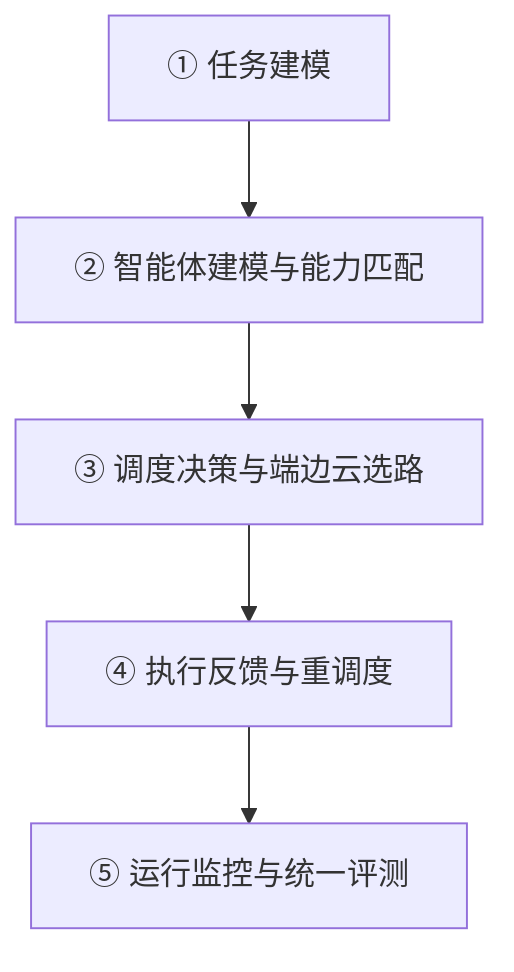

# 第四章 多智能体协同调度与任务分配机制研究

> **适用范围**：02-技术报告.doc 第四章，替换模板中原有的四个占位小节。
> 4.1—4.4 对应模板原有四个小节，4.5（建图任务协同调度专题）、4.6（实现结构与问题整改）、4.7（小结与演进）为新增小节。
>
> **编写口径**：本章聚焦问题定义、解决方案与技术方法，**不列实验结果、检测结论与运行数值**；量化要求的达成情况与第三方测评结论统一在工作报告与相应报告中给出。文中数值均为算法参数、状态机上限或需求条款本身的要求；凡属设计路线尚未工程落地的内容，仍显式标注【设计路线，未工程落地】，避免把方案写成既成事实。
>
> 本章研究对象是任务书研究内容（4）多智能体任务分配与边缘智能决策系统。可研报告中的 CBBA、PSO/GA、GNN-RL 等属于**算法设计路线**；本项目中已落地并经过验证的是由大模型任务分解、可判定语义契约、端边云路由、有界重规划与统一评测构成的工程实现。凡属设计路线尚未工程落地的内容，文中均明确标注，避免把方案写成既成事实。

---

## 4.1 调度问题建模与总体架构

### 4.1.1 问题定义与优化目标

设巡检任务集 $T=\{t_1,\dots,t_m\}$，每个任务具有位置、所需传感器能力、优先级、时效窗口与预计耗时；智能体集合 $A=\{a_1,\dots,a_n\}$ 由空中无人机（UAV）、地面机器狗（DOG）及无专属物理平台的协同算力（SHARED）构成，每个智能体具有速度、续航、载荷、感知半径与可用工具集。调度需求可表述为带约束的多目标分配：

$$\min_{X}\ \Big(\ \alpha\,T_{\text{makespan}}(X)+\beta\,L_{\text{imbalance}}(X)+\gamma\,E_{\text{energy}}(X)-\delta\,P_{\text{priority}}(X)\ \Big)$$

约束包括：能力匹配（$t_j$ 所需传感器必须由 $a_i$ 具备）、依赖闭合（子任务 DAG 无环且前置完成）、电量与航时下限、安全与时间窗、平台互斥（同一狭窄通道/起降点的时空冲突）、隐私等级与算力层级约束。$X_{ij}=1$ 表示任务 $j$ 分配给智能体 $i$。

变电站场景的特殊性在于：任务与平台并非任意组合，而是强耦合——高空绝缘子、避雷器、刀闸需要 UAV；表计读数、开关柜近距检查、设备底部需要 DOG；脱敏、剪辑、大模型分析属于 SHARED。分配失误不是效率问题，而是任务根本无法完成。因此本系统把能力匹配作为**可判定的硬约束**，而不是目标函数里的软惩罚。

### 4.1.2 双维度正交：物理平台 × 计算层级

工程实现中容易出现的偏差，是把物理执行体归属与计算落点混为一谈。本系统因此显式建立两个正交维度：Platform 取 UAV、DOG 与 SHARED，表示物理执行体，决定航点、动作与遥测由哪个平台产生；RouteTier 取 edge 与 cloud，表示计算落点，决定推理与数据处理在本地边缘还是云端完成。两者之所以必须分开，是因为空地协同中大量任务的执行体与计算落点并不重合——无人机采集的影像可以在云端做稠密重建，没有专属物理平台的脱敏处理却因隐私要求必须留在边侧。

每个子任务同时带两个标签，每个执行步 TraceStep 同时记录 platform 与 tier_used。归一化函数 normalize_platform() 兼容中英文表述，把无人机、航拍、空中等归一为 UAV，把机器狗、四足、地面、表计、开关柜、近距等归一为 DOG，未知表述统一回落 SHARED，避免大模型自由表述导致误判。

两个维度在语义理解下可以独立取值，可通过一组典型子任务加以说明。map_query 与 route_plan 都分配至 DOG 并落在 edge：前者是地面平台对可通行性的查询，后者是地面导航在真实栅格上的 `A*` 规划，二者物理执行体与计算落点恰好一致，但回答的问题完全不同。同为 camera 采集工具，高空航拍的子任务分配至 UAV，地面近距细查的子任务分配至 DOG，二者都在 edge 完成，说明同一个工具可以对应不同的物理平台；反过来，edit 剪辑渲染与 anonymize 脱敏都没有专属物理平台，统一分配至 SHARED，前者因需要渲染算力落在 cloud，后者因隐私敏感落在 edge，说明同一平台也可以按隐私与算力要求选择不同计算层级。这组对应关系揭示的正是正交建模的价值：若把物理执行体归属与计算落点压缩为单一字段，UAV 采集而云端分析、无专属平台却必须边侧处理这类组合便无从表达，只能在代码中固化特例，一旦新增任务类型就要改动调度主流程。

### 4.1.3 五层协同调度技术路线

按任务建模、智能体建模、协同调度决策、执行反馈与监控评价五层组织，层间以显式数据契约（Plan / SubTask / TraceStep / ToolResult / EvalRecord）通信，不共享可变状态。

**图 4-1 多智能体协同调度五层技术路线**

### 4.1.4 研究边界与验证思路

本章解决的是**决策层面**的三个问题：任务与智能体能力如何建模才能被机器判定、分配结果如何在端—边—云之间正确路由、长链条执行出错后如何有界恢复。传感器接入、协同控制软件、缺陷识别模型与现场部署分属其他任务包，本章只消费其接口，不重复实现。

验证按结构可判定、执行可恢复、通道可替换与现场可联动四步组织：先以结构化校验保证计划合法、工具可达、平台明确；再以前置条件引擎与有界重规划保证执行时能力匹配仍成立；随后用可替换执行通道检验决策层与物理通道的解耦；最后由第三方测评与现场应用验证确认完整链路。各步关注的问题与手段见表 4-2，本章不列测试结果与检测结论。

**表 4-2 验证步骤与关注问题**

| 步骤 | 关注问题 | 采用手段 | 对应小节 |
| --- | --- | --- | --- |
| 结构可判定 | 计划是否合法、工具是否可达、平台是否明确 | 计划结构校验与目标对齐 | 4.2.2 / 4.4.1 |
| 执行可恢复 | 前置条件不满足时能否拦截、失败后能否有界重规划 | ReAct 循环、前置校验、Reflexion 归因 | 4.4.2 / 4.4.3 |
| 通道可替换 | 更换执行通道后决策层是否无需修改 | 语义契约与执行通道解耦测试 | 4.4.4 / 4.6.1 |
| 现场可联动 | 完整系统在真实环境中的表现 | 第三方测评与现场应用验证 | 工作报告与应用报告 |

> 需求规格说明书 2.3 节对任务建模、协同调度与边缘决策均标注为参考要求且可自定，未给出具体性能指标；本章不为其设置指标，落实方式见 4.1.5 节的符合性说明。原型自设的端侧模型合入门槛属于研究阶段的内部设计约束，既非说明书要求也非合同指标，不作达标结论。

### 4.1.5 需求规格符合性与任务分工界定

本章对应《需求规格说明书与任务分工》2.3 节（多智能体任务分配与边缘智能决策系统需求）与 3.5 节任务五（T5，负责人：孔凡华）。任务五规定两项工作内容：其一，基于多目标优化与图神经网络强化学习等方法设计集中式与分布式调度算法，建立基础调度算法性能评估的评测维度与归因口径（说明书未给数值门限）；其二，开发边缘智能决策，结合任务紧急度、设备状态、覆盖范围进行任务划分，在路径规划上完成任务分配与时间协同、空地双智能体路径协同与调度优化。交付物为系统 1 套（含源代码）、算法性能测试报告与接口规范各 1 份。说明书同时明确 T5 可与 T4 结合、有一定程度区分：本章承担动作的执行主体、执行时序与计算层级，第三章承担地图与路径的生成方法，两者以地图版本号与航点契约衔接（见 4.5.5 节）。

> **表述口径**：本章按功能要求、实现方法与验证方式及交付形式三段组织对需求规格的响应，**不以指标或实验数据形式表述**；说明书中标注为参考要求、可自定、可接受或无固定约束的条款，不设数值门限、不作达标承诺，验证方式为功能演示、运行记录核对与现场确认。说明书中未给出具体性能指标的条款，本报告不自行补设指标。合同中另有的量化要求与第三方测评结论，统一在工作报告中列示。

**表 4-10 需求规格条款与本章实现对照（T5）**

| 需求条款 | 条款要求（说明书未设数值者按定性表述） | 本章对应实现 | 落实方式 / 交付形式 |
| --- | --- | --- | --- |
| 2.3.1(1) | 任务细粒度分解（巡视摄像、红外测温、表计识别、异音检测），带位置/资源/优先级/时效 | 4.2.1 任务属性建模；4.2.2 Planner 分解 | 已落地：系统源码、Plan DAG |
| 2.3.1(2)(3) | 智能体能力参数集（感知半径、续航、载荷、任务效率、导航）；多维特征空间任务—能力匹配 | 4.2.1 能力图谱；4.4.1 语义契约把匹配做成硬约束 | 已落地（原型以工具能力集表达，见 4.2.1 说明） |
| 2.3.2(1) | 紧急度、设备状态、覆盖范围多目标划分；时间窗优化 | 4.1.1 多目标优化模型；4.3.1 设计路线与工程实现的区分 | 优化模型已定义；PSO、GA 与 GNN-RL、集中式与分布式调度为【设计路线，未工程落地】 |
| 2.3.2(2) | 空地路径协同：UAV 主导建图与粗定位，DOG 执行高精度检测与局部补盲 | 4.1.2 双维度正交分配与典型子任务对应关系 | 已落地（分配逻辑在原型中实现） |
| 2.3.2(3) | 执行失败触发任务回滚，并重新分配至其他可用智能体 | 4.4.1 Rollback 契约；4.4.2 有界重规划；4.4.4 容错 | 回滚与局部重调度已落地；跨智能体再分配待工程落地 |
| 2.3.3(1) | 边缘本地实时决策、自主行为调整、低延迟闭环自主控制 | 4.3.2 Router 边缘优先；4.3.3 端侧 VLA 时延优化 | 路由与降级已落地；端侧时延由优化模型推演，尚未接入真实推理引擎 |
| 2.3.3(2) | 边缘优先、云端补充，复杂场景上传云端精细分析 | 4.3.2 端—边—云判定树；4.5.2 重建计算卸载 | 判定树已落地；资源感知卸载为【设计路线，未工程落地】 |
| T5(1) | 建立基础调度算法性能评估的评测维度与归因口径（说明书未设数值门限） | 4.4.5 统一评测与跨层归因 | 已落地：以完成率、动作合理度、分位时延、失败层级归因作为研究观测项，用于版本间比较；不作为验收指标 |

> 说明书 2.3 节多处标注为参考要求且可自定，全节未给出具体性能指标；1.2 节第（11）条亦明确本项目侧重完整度与工作量、允许存在技术探索和技术不成熟。因此本章对该节条款一律按功能要求、实现方法与验证及交付方式三段表述，不设数值门限、不作达标承诺；对尚未工程落地的算法路线显式标注，既不隐瞒，也不把设计方案写成已完成实现。平台侧的参考续航能力、通信方式与传感器接入数量（见说明书 2.1 与 2.7 节）由 T1 / T3 承担，本章仅将其作为能力匹配与路由判定的输入约束，不重复列为验证要求。

---

## 4.2 任务—能力匹配与结构化任务分解

### 4.2.1 任务属性与能力图谱建模

任务侧建立标准任务库，字段包括：任务类型、位置（世界坐标/栅格坐标）、所需传感器能力、预计耗时、优先级、时效窗口、前置依赖与成功判据。智能体侧建立能力参数集与限制条件，原型中可直接核对的参数包括平台速度、最低电量阈值、单次调用超时与仿真加速比等，均通过配置文件与仿真配置统一管理。

需求规格 2.3.1(2) 要求对无人机与机器狗分别建立能力参数集（感知半径、续航时间、载荷能力、任务效率、导航能力），并在多维特征空间下建立任务—智能体适配映射。原型按可判定优先原则把五类参数落到可核对字段：感知半径与导航能力由工具集的 platform_hint 及 map_query 与 route_plan 可通行性查询间接表达，载荷能力由传感器与工具能力集表达，任务效率由速度参数与单步超时表达，续航时间由最低电量阈值与仿真能耗模型表达。尚未实现统一的能力向量编码与多维特征空间匹配，该部分属【设计路线，未工程落地】；现有字段已足以支撑能力匹配为硬约束这一调度目标。

异构平台的差异可从五个维度刻画，每一维度都直接对应一条调度含义。视角与覆盖方面，无人机俯视视野广、高空可达，机器狗只能获得近距视图却能进入低矮与遮挡区域，因此前者用于粗筛与全局建图、后者用于细查与补盲；机动与速度方面，无人机快而适合广域扫描，机器狗慢而适合近距细查，两者在路径接续处必须做时间窗匹配，否则快的一方会在汇合点空等；续航与补能方面，无人机续航短、依赖起降与补能点，机器狗续航相对长、可作为移动平台，由此引出能源管控与狗载起降的协同设计；载荷方面，无人机携带可见光、红外与 LiDAR，机器狗携带二维 LiDAR、深度相机以及声学与气体传感器，这决定了任务所需传感器—平台可用载荷必须作为硬匹配条件，而非可以折衷的软约束；受扰因素方面，无人机主要受风、电磁干扰与 GPS 失真影响，机器狗主要受地形、落差与狭小通道影响，两类扰动分别进入语义风险代价与局部避障策略。五个维度合起来说明：平台差异不是效率高低之分，而是能力边界之分，这也解释了 4.1.1 节为何把能力匹配写成硬约束。

### 4.2.2 Planner：目标分解与结构化校验

规划层以 LangGraph 状态图实现分解、校验与重规划循环，只负责产出带成功判据的 DAG，不触碰工具参数、不执行动作。输出结构包含根目标 root_goal、成功判据 success_criteria，以及由标识、描述、前置依赖、工具提示、成功判据与平台标签构成的子任务列表。校验包含：子任务非空、依赖无环、tool_hint 必须来自已注册工具集、成功判据可观测；控制规模为 4~6 个子任务。校验失败时把错误回灌下一轮分解，最多重试 3 次。

平台判定优先级依次为显式平台字段、子任务标识与描述关键词推断、工具的平台提示字段，最后回落至 SHARED。凡涉及实地采集/巡检的任务必须显式分配至 UAV 或 DOG，避免一律落入 SHARED。

Plan.validate_acyclic() 以 DFS 检测环，topo_order() 给出拓扑序，ready_nodes() 返回依赖已完成且自身未完成的节点集合；SubTask.to_registry() 把每个子任务的成功判据登记到 GoalRegistry，形成全局目标的机器可读表示。

### 4.2.3 目标寄存器与动作对齐

GoalRegistry.is_aligned(tool, subtask_id) 是防止长程任务偏离既定目标的关键机制：Reasoner 每步产生的 Action 必须绑定到当前计划内、仍待完成的子任务，否则直接拦截并上报阻断，而不是让模型换一个看似合理的工具继续执行。该机制把动作是否服务于当前子任务转化为可判定的一致性条件，而不是依赖模型自觉。

---

## 4.3 协同调度决策与端—边—云路由

### 4.3.1 任务分配优化：设计路线与工程实现的关系

可研报告设计了三条算法路线：① 以蚁群、PSO 与 GA 等元启发式方法求执行时间、负载均衡与能耗的 Pareto 最优解；② 以 GNN 建模任务图与能力图，配合 DDPG/PPO 做动态调度；③ 面向通信受限场景的分布式调度框架（CBBA 式共识 bundling 与时间窗优化）。

本项目中**已工程落地并验证**的实现是：大模型依据任务语义与工具集完成分解与平台判定，规则化校验保证 DAG 合法、工具可达、平台明确，前置条件引擎保证能力匹配在执行时再次被硬校验；分配结果以 Plan 结构落盘、可回放、可归因。元启发式与 GNN-RL 属于后续算法增强路线，尚未接入生产链路，故本章不对其作量化承诺。这一分层处理的理由是：在真机接入前，先保证分配结果可判定、可解释、出错可恢复，比追求 Pareto 最优更为关键。

### 4.3.2 Router：端—边—云判定树与失败回退

每个工具在 RouteHint 中声明计算强度（LOW、MEDIUM 与 HIGH）、时延预算、隐私等级与是否具备边缘执行能力。Router 结合 NetworkGovernor 的链路状态按判定树选路，如图 4-2。

**图 4-2 端—边—云选路与失败回退**

Router 的默认行为由配置驱动：边侧与云端分别设定时延预算，链路 RTT 超过降级阈值时触发回退，指数退避的基数与上限均可配置。回退策略包括 escalate_cloud / degrade_edge / hold_stale / retry_backoff / edge_cache，选路结果写入 TraceStep.tier_used，使每一次降级都可追溯。面向重建类长时任务的资源感知卸载扩展见 4.5.2 节。

> **实现状态说明**：NetworkGovernor 的链路 RTT 由随机数生成，**不探测真实网络**；该模块当前只用于验证路由逻辑本身的正确性。

### 4.3.3 边缘智能与端侧 VLA 时延优化

端侧部署轻量视觉—语言—动作（VLA）模型，用于导航控制与近距动作决策。原型把推理时延的压缩分解为三层可叠加的手段，依次为结构层（稀疏专家与知识蒸馏）、量化层（低比特权重量化）与算子层（融合注意力与分页显存管理），每层以收益系数描述对基线时延的削减，用于比较不同优化组合的预期效果。该模型是**优化思路的建模**，不是真实推理测量；真实端侧模型、量化与推理引擎尚未接入，合入前另设工程约束，实测时延分布需在阶段 D 补齐。

### 4.3.4 通信与状态同步

异构平台间通过 5G、WiFi 与 LoRa 与边缘中继交换任务指令、位置状态与感知结果；系统定义轻量级任务指令接口与统一反馈编码（成功标志、失败原因、消耗能量、剩余航时、避障状态）。指令下发、状态回传与异常告警均在统一反馈编码中闭环，便于执行层与调度层核对。

---

## 4.4 执行反馈、容错重调度与安全机制

### 4.4.1 ToolSpec 语义契约：将可执行性转化为可判定条件

工具不再只有自然语言描述，而是显式声明 preconditions（前置条件）、effects（执行后对世界状态的副作用）、rollback（可逆操作）与 route（路由提示）。WorldState 引擎用 Condition（== / != / >= / <= / exists / not_exists）逐条判定，不满足即阻断并升级重规划，**不允许擅自替换工具**。这是从机制上杜绝工具误调用的核心，也是任务—能力硬匹配在执行阶段的落点。

ToolSpec 的六个字段各自承担一类可判定信息。preconditions 以 scene_loaded == True、safety_cleared == True 一类的条件声明动作得以执行的前提，由世界状态引擎逐条硬校验，不满足即阻断；effects 声明执行后对世界状态的写回，例如把 route_ready 置为 True、把 route_len_m 写为计算里程，使后续步骤的前置判定有据可依；rollback 声明失败时的可逆操作，是任务回滚与继任机制的基础；route 携带计算强度、时延预算、隐私等级与边缘执行能力，作为端—边—云选路的输入；platform_hint 给出 UAV、DOG 与 SHARED 的兜底依据，供 Planner 在描述里没有显式平台时使用；compute_only 对纯计算工具置 True，禁止执行通道以静态声明值覆盖真实计算结果。六个字段把工具的可执行性、执行后的世界状态、失败回退方式、计算层级、平台归属与结果来源要求一次性固定下来，决策层因此不再需要解析自然语言描述，也不必依赖模型自觉；任一字段缺失都会把某类判断重新推回隐式约定，而这正是长链条执行最容易出错的地方。

### 4.4.2 Reasoner：ReAct 循环、有界重规划与 Reflexion

决策层以 LangGraph 状态图实现由 select、reason、execute 与 post 四个阶段构成的完整闭环，并按继续、重规划、反思或取消四类分支转移。select 阶段从 ready_nodes() 取就绪节点，急停令牌在这一步优先检查，全局步数设有上限 32，避免模型在长链条上无限展开；reason 阶段按 ReAct 形式产出 Thought 与 Action，并立即用 GoalRegistry.is_aligned() 做动作对齐，凡不绑定当前待完成子任务的动作直接拦截；execute 阶段依次执行前置校验、路由决策、执行通道调用，再把语义 Effect 与物理遥测一并回写并生成 TraceStep；post 阶段在成功时推进计划，在阻断时进入有上限 2 次的重规划并把历史 lessons 注入 Planner，若仍失败则触发 Reflexion，生成 self-critique 与经验条目沉淀到经验库。上述上限与终止分支共同保证可恢复不等于无限重试：任何异常最终都会落到一个明确的终止状态并留下归因记录，而不是把系统拖入不可收敛的循环。

**图 4-3 Reasoner 有界重规划闭环**

失败归因把症状映射到五类层级：PLANNING（分解错误 / 可行性缺失）、ACTION（工具误调用 / 前置违例）、INFERENCE（端侧时延 / 精度）、NETWORK（抖动 / 回退失效）、INTERACTION（目标歧义 / 用户不满），为后续调度模型优化提供可定位的根因。

> **当前限制**：Reasoner 取 ready_nodes()[0] **串行执行**，尚未利用无人机与机器狗可并行的物理条件。空地并行调度（按平台分组并发、冲突消解、时间窗对齐）是下一阶段（阶段 C）的重点，本报告不把它表述为已完成能力。

### 4.4.3 执行通道解耦与可替换性

ToolSpec（语义契约）与 ToolAdapter（执行通道）分离后，切换 Mock、仿真、录播与真机通道对 Planner、Reasoner、Router 与评测均无影响：接入真机只需替换 Adapter，决策层无需修改。五类通道的具体语义见第三章 3.4.3 节，其中 sim 通道提供真实墙钟耗时、真实超时、可取消与遥测回传四要素，playback 提供确定性复现，ros2 与 zsibot 为真机接入位。

**图 4-4 语义契约与执行通道解耦**

该解耦是从原型走向部署最关键的接口决定：真机语义差异被收敛在适配器内，包括声明的语义 Effect 必须与物理遥测合并回写这一约束；若只回传电量而丢失 footage、edited 等语义事实，后续步骤将被前置校验全线阻断并误触发 Reflexion。

### 4.4.4 异常处理、急停与任务容错

异常检测覆盖电池异常、导航失效、链路中断、工具超时与执行失败。处置策略包括：任务回滚与继任（失败任务重新分配给可用智能体）、局部重调度（不推翻已完成节点）、路径回滚、hold_stale 保持上一可信状态、指数退避重试。

急停是安全红线：CancellationToken 取消后，状态图直接进入 cancelled 终止分支，不再进入重规划或 Reflexion。硬件在环仿真曾暴露急停后仍继续自主行动的缺陷，增加终止分支后该问题被消除；该结论是软件行为层面的验证，不等同于真机停机表现。真机部署时 safety_cleared 必须由硬件安全联锁真实写入，不能沿用原型内置默认值。

需求规格 2.3.2(3) 要求，当某一智能体任务执行失败时，调度系统应能触发任务回滚机制并重新分配至其他可用智能体。原型已实现 Rollback 契约、局部重调度与有界重规划；跨智能体再分配（在 UAV 与 DOG 之间重新指派）目前作为策略配置项保留，尚未在真实硬件上验证，标注为【设计路线，未工程落地】，不纳入已验证能力范围。

### 4.4.5 统一评测与跨层归因

系统以 task + trace_id 贯穿规划层、动作层、端侧推理层与网络层，评测侧据此定义一组用于版本间比较的观测量，按计划是否成立、动作是否守约、时延分布如何、失败出在哪一层四组组织。planning_success 记录是否产出结构合法且非空的 Plan，用来判定计划本身是否可用；action_rationality 由前置违例步数与总步数之比构造，用来判定动作是否偏离语义契约；latency_p50、p95 与 p99 给出单步时延的分位数，end_to_end_ms 给出各步时延之和，二者分别用于比较不同版本的时延分布形态与端到端开销；precondition_violations 累计前置校验违例次数，用来定位能力匹配在何处失效；csat 由外部传入用户满意度，作为主观评价输入；root_cause_layer 记录失败层级归因，供二分定位根因使用。七类维度共同构成版本间可比较的基线，而不是验收结论。

评测体系在此之上还提供三项工程手段：离线回放可逐层二分定位根因，失效案例归因矩阵把反复出现的失败模式沉淀为可检索条目，A/B 影子模式护栏在时延劣化超过设定阈值时自动回滚策略版本，使调度策略调整既有可比较的基线、也有可撤回的退路。上述维度属于研究系统内部观测项，不是说明书或合同的验收指标，本章不列具体跑测值。

---

## 4.5 面向建图任务的协同调度扩展（新增专题）

> **与前四节的关系**：4.1—4.4 讨论的是巡检任务的分解、分配、路由与执行，而建图本身同样是一类需要被分配、被卸载、被同步、被容错的任务。本节把第三章 3.5 节的快速重建链路纳入第四章的调度框架，说明其任务分解、算力卸载、地图版本一致性与并行化设计。
>
> **落地状态标注**：本节中双维度标签、语义契约、前置校验、有界重规划与 compute_only 工具为已在原型中实现的能力；GPU 资源探测与卸载、地图版本驱动的重调度、按平台并发调度为接口设计或后续演进路线，标注【设计路线，未工程落地】，不作为已完成能力表述，也不作量化承诺。

### 4.5.1 建图类任务的分解与平台—层级双标签

一次地图更新并非单一动作，而是一组有时序依赖的子任务。按 4.2.2 节的 SubTask 结构建模后，六个子任务、它们的依赖关系、平台与层级标签、成功判据以及主要资源约束可按执行顺序叙述如下。

链条由视角规划与航点生成开始，它依赖任务下发，分配至 UAV / edge，成功判据是覆盖目标设备区且视角数 n_views 达标，主要受航时、安全距离与禁飞区约束；随后空中影像采集依赖视角规划，仍由 UAV 在 edge 完成，成功判据是影像帧数与位姿记录齐全，约束来自续航、光照与链路带宽。第三步位姿恢复与稠密重建依赖影像采集，是纯计算任务，分配至 SHARED 并按 GPU 可用性落在 cloud 或 edge，成功判据为导出基元、位姿与质量评价量，主要受 GPU 显存、迭代预算与训练耗时约束。第四步占据栅格化与地图发布依赖稠密重建，分配至 SHARED / edge，以栅格尺寸、已知率与地图版本号加一为成功判据，约束是坐标系标定已完成且版本号单调推进。第五步地面补盲采集在地图发布之后由 DOG 在 edge 执行，以低矮与遮挡区域增补观测的回写为成功判据，受通道可达性与局部刷新率约束。最后地图质量校验依赖全部前置节点，由 SHARED / edge 承担，以重建质量、几何量测与路径一致性为判据，前提是测试视角的留出方式正确。六个子任务共用同一套 Planner 分解、Plan.validate_acyclic() 校验与 GoalRegistry 对齐，不引入第二套调度器，这是 4.3.1 节先保证可判定、可解释、出错可恢复这一原则在建图场景下的延续。

分配上有三点与巡检任务明显不同。其一是采集与计算必须分离：影像采集只能由 UAV 完成，属物理平台硬约束，而稠密重建是纯计算任务，分配至 SHARED 并单独决定计算层级；这正是 4.1.2 节物理平台与计算层级正交建模的适用场景——若把两者合并成一个 UAV 任务，就没有办法把重建卸载到边缘 GPU，平台标签反而成了算力调度的障碍。其二是重建属于长时任务：一次训练约万次迭代（见 3.5.6 节），必须在 SubTask 中显式声明迭代预算、超时预算与可取消语义，执行期间允许取消并回退到上一版地图，而不是让调度器无限等待一个不会失败也不会结束的节点。其三是地图发布构成同步屏障：在发布完成之前，下游的 route_plan、map_query 等感知工具不得基于半成品地图计算。该约束由 DAG 依赖与前置条件共同保证，而不是靠调度器记忆顺序，因此即使后续引入并发派发也不会被绕过。

### 4.5.2 重建计算的端—边—云卸载与资源约束

4.3.2 节的路由判定树以隐私、时延预算与算力强度为输入。对重建类重计算任务，需要把 RouteHint 扩展为包含算力资源维度的声明：计算强度 GPU_HIGH、显存需求、迭代预算、输入分辨率、隐私等级与可接受降级方式。判定逻辑按资源声明、层级判定、降级保底与地图版本发布四步组织。

降级策略的设计目标是保证地图可用，而非保证重建结果完备：宁可输出一份分辨率较低、迭代预算较少的地图并显式标注其质量，也不让下游在无地图可用时静默沿用过期数据。HOLD_STALE 分支必须同时产出告警事件，使 4.4.5 节的归因矩阵可定位到 NETWORK 层。

> **落地状态**：当前 Router 已实现 tier_hint 判定、云端降级、边侧回退与指数退避；但 NetworkGovernor 的链路 RTT 由随机数生成（见 4.3.2 节实现状态说明），**尚无真实 GPU 显存与算力探测与资源感知选路**，上述资源分支属于【设计路线，未工程落地】，现场部署前需接入真实资源监控。

### 4.5.3 地图版本一致性与事件驱动重调度

空地协同最容易出现的一类隐蔽错误，是**两个平台基于不同版本的地图同时决策**：无人机刚发布第 $k$ 版地图，机器狗仍按第 $k-1$ 版规划的路径行进；若新版地图把某条通道标为障碍，旧路径就会把机器人引向危险区域。为此需要把地图版本提升为世界状态的一等事实。

具体做法是让 SceneModel.to_facts() 在既有地图事实之外增加 scene_version 一类版本事实（scene_known_ratio 等已落地，见 3.4.2 节），再让每个依赖地图的子任务在 preconditions 中显式声明 scene_version == k；地图发布则作为 effects 把 scene_version 置为 k+1，并广播局部层的增量块（见 3.2.6 节的分层增量式共享地图）。版本一旦推进，仍挂在旧版本上的就绪节点会被 WorldState 判定为前置不满足，从而进入 4.4.2 节的有界重规划（上限 2 次）；若仍失败则触发 Reflexion 归因，归因层级记为 PLANNING 并附 map_version 字段，便于回放时二分复现。这样，版本冲突不再是调度器内部一个容易遗漏的隐式状态，而是可被 Condition 判定、可被 TraceStep 记录、可离线回放的显式事实。

按事件类型展开，处置规则与回写边界如下。

地图发布成功时 scene_version 加一，系统唤醒依赖新地图的就绪节点，同时阻断旧版本节点并做局部重规划，回写时保留已完成节点、不推翻整个计划；局部层增量更新带来占据格变化或动态障碍时，只重算受影响的路径段并触发 3.3.2 节的局部重构，刻意不推进版本号，以免频繁的增量广播造成重规划抖动；重建失败或超时时 scene_version 保持不变，系统进入 HOLD_STALE 并配合指数退避重试，同时发出告警、沿用上一份可信地图，绝不允许静默降级为地图不可用的状态；重建被急停取消时状态图直接进入 cancelled，立即停止训练与发布，不进入重规划或反思，与 4.4.4 节的急停语义完全一致；地面补盲发现新障碍时 scene_known_ratio 上升，系统广播增量块并对受影响子任务重规划，回写必须带来源平台与时间戳，避免两个平台对同一格重复写回。五类事件分别对应正常推进、局部变化、失败保底、紧急停止与双侧并发写回五种情形，其共同原则是：任何一次地图变化都须同时明确版本号的变更方式、需要重算的节点范围，以及失败时下游可见的状态。

正因地图版本已成为可判定的显式事实，版本冲突能够在测试阶段稳定复现，而不必等到真机联调。

> **落地状态**：to_facts() 注入真实地图事实、前置条件硬校验、重规划与 Reflexion 归因均已在原型中实现；scene_version 字段、版本驱动的事件唤醒与增量块广播属于【设计路线，未工程落地】，当前原型以单版本静态地图运行。

### 4.5.4 从串行到空地并行的调度设计

4.4.2 节已明确当前限制：Reasoner 取 ready_nodes()[0] 串行执行，尚未利用无人机与机器狗可并行的物理条件。建图场景把这一限制暴露得更明显——UAV 在做广域采集时，DOG 完全可以同步做低矮区域补盲，两者本无依赖，却被串行队列强制排队执行。

面向阶段 C 的并行调度设计如下。设就绪节点集合 $R$，按物理平台分组 $R_{\text{UAV}}$、$R_{\text{DOG}}$、$R_{\text{SHARED}}$，并发可行性条件为：

$$\forall\, i,j\in R,\ i\ne j:\quad \text{conflict}(i,j)=0\ \wedge\ \text{dep}(i)\subseteq \text{Done}\ \wedge\ \text{tw}(i)\cap\text{tw}(j)\ \text{可共存}$$

其中 $\text{conflict}(i,j)$ 为时空冲突矩阵（同一狭窄通道、同一起降点、同一空域层），$\text{tw}(\cdot)$ 为时间窗。满足则可并发派发；不满足则退化为按拓扑序串行，并在 TraceStep 中记录退化原因。共享算力组按队列执行，避免多个重建任务竞争同一块 GPU。同步屏障设在地图发布与质量校验两处：发布前所有采集子任务必须完成，校验通过后才允许下游规划节点唤醒。该并行方案尚处于设计阶段。

理论收益来自把无依赖的采集类子任务并行化，但收益大小取决于任务图的并行度与冲突率；本项目**尚无真机并行实测数据**，不给量化结论，并标注【设计路线，未工程落地】。需要特别强调的是，并行化不能绕过 4.4.4 节的急停语义：任一平台急停，其余并发分支必须一并进入 cancelled，否则会出现一处停机、另一处继续自主行动的风险。

### 4.5.5 与第三章的接口契约和验证状态

把建图链路接入调度框架，最终要落到 ToolSpec 的字段上。已落地的四个感知工具（scene_inspect、map_query、route_plan、height_probe）均标记 compute_only=True，其观测来自真实计算、不被执行通道的静态声明值覆盖（3.4.1 节）；重建、栅格化、地图发布三类工具建议按同样纪律声明：

在 preconditions 中应声明 scene_loaded == True、标定完成、scene_version == k 以及 GPU 资源可用（后一项属设计路线），保证重建不会在地图未就绪或版本不匹配时启动；effects 应产出 footage、scene_version、scene_known_ratio 与 route_ready 等世界状态事实，使下游的前置判定有确定输入；rollback 必须规定重建失败时回退到上一可信地图版本，不得留下半成品被后续节点误读；route 应携带算力强度、显存需求、迭代预算、隐私等级与可接受的降级方式，供 4.5.2 节的资源感知卸载使用；compute_only 则要求栅格化与质量校验这类纯计算工具一律置 True，保证真实计算结果不被执行通道的模板观测覆盖。五类字段与已落地的四个感知工具完全同构，说明建图链路接入调度框架并不需要扩展机制本身，只需把新的任务按既有契约声明清楚。

当前实现状态可归纳为三点：其一，双维度标签、DAG 校验、前置条件硬校验、有界重规划、compute_only 与急停终止分支均已在原型中实现并有回归用例覆盖；其二，GPU 资源探测、版本驱动唤醒、按平台并发派发与时空冲突矩阵仍属设计路线，标注【设计路线，未工程落地】；其三，链路 RTT、端侧 VLA 时延、电量与里程仍为推演值，并行调度一旦上真机，需以现场遥测替换。

这也解释了 4.7 节演进路线为何把接单台真机放在空地并行协同之前：先把单机时序、能耗与安全联锁标定清楚，再讨论并发与时间窗对齐，才有可比较的基线。

---

## 4.6 实现结构与问题整改（新增小节）

> 本节只说明**系统如何实现、用什么方法验证、遇到过什么边界问题**，不列测试结果、检测结论与运行数值。量化要求的达成情况与第三方测评结论见工作报告及相应报告原文。

### 4.6.1 实现结构

原型系统采用 Python + LangGraph + Pydantic v2，规划层与决策层均为 StateGraph；LLM 后端可插拔（离线 mock / 生产 OpenAI 兼容接口）；服务以标准库 ThreadingHTTPServer + SSE 提供流式事件。分层结构使任务分解、动作对齐、路由选路、执行通道与评测归因各自独立，任一层的替换不影响其他层，便于按阶段接入真机与真实端侧模型。

回归用例按模块分层组织，覆盖从感知到评测的完整链路。感知层覆盖坐标转换、占据查询、连通性判定、绕障、点云剖面以及通道与场景的耦合关系；执行通道层覆盖通道语义、超时、取消、故障注入、遥测与语义 Effect 回写，重点验证更换通道后决策逻辑保持不变；机器狗桥接层覆盖任务编译、坐标变换、导航帧构造、daemon 指令与 dry_run 安全阀；虚拟狗联调层覆盖全链路、适配器直调与急停三种运行方式；规划与世界状态层覆盖计划结构、目标对齐、平台判定、条件判定与 Effect 应用；评测、推理、路由与执行器层则覆盖评测归因、ReAct 流程、路由降级与执行器前置阻断。这样的分层使一次失败可以被定位到具体模块，而不是笼统地记为端到端执行失败，也为后续接入真机时逐块替换通道保留了可比较的回归基线。

### 4.6.2 端到端验证的设计要点

端到端验证采用真实语义规划、真实感知计算与硬件在环仿真执行相结合的方式，关注三件事：模型能否基于任务语义自主选用感知工具、分配结果能否被语义契约硬校验、执行失败能否有界恢复并归因。其中，感知工具由模型自主编入计划并真实调用是关键判据，它说明任务分配并非把工具固定编码于流程中，而是由语义理解产生并受契约约束。验证的具体结果不在本章列示。

### 4.6.3 联调暴露的问题与整改方法

联调暴露的问题可按成因分为三组。第一组是服务与前端的状态管理问题：事件钩子误吞状态重置块，导致每次事件推送都清空计划、任务无法推进，整改办法是把重置逻辑移回构造函数；SSE 连接不关闭，前端会持续显示运行中状态，整改办法是显式设置 Connection: close 并在收到 end 事件后置位；端口上残留多进程同时监听，返回旧代码的结果造成调试误判，整改办法是启动前校验单实例监听。第二组是执行通道与上下文的语义问题：仿真通道忽略上下文传入的超时预算，使超时参数无法发挥预期作用，改为统一使用 ctx.timeout_ms；适配器只回传电量而不回写语义 Effect，使后续步骤全线阻断并误触发 Reflexion，改为语义 Effect 与物理遥测合并回写；急停之后仍继续重规划，停机不及时且存在安全风险，改为新增 cancelled 终止分支；纯计算工具的真实结果被模板观测覆盖，使感知工具无法发挥预期作用，改为引入 compute_only 语义。第三组是初始状态问题：Web 默认初始世界状态为空，页面一打开就因安全条件缺失而全败，整改办法是新增 Orchestrator.DEFAULT_WS 并支持 ws_init 覆盖，同时明确真机部署时这些字段必须由安全联锁与遥测真实写入。

其中不回写语义 Effect、急停后继续重规划、真实结果被模板覆盖与初始状态为空四项都属于模块边界语义问题，在纯 Mock 模式下不会暴露，因为工具零耗时、必然成功、也没有真实的前置条件。只有引入硬件在环仿真与真实数据接入之后，这些缺陷才会稳定复现。这既是本章把语义契约与执行通道显式分离的直接原因，也说明第四章的可判定、可恢复能力不能只靠结构校验，必须配合能暴露真实时序与真实状态的执行通道来验证。

### 4.6.4 成果形式

与本章直接相关的方法成果已形成软件著作权登记与发明专利申请，清单、受理状态与第三方检测与测评报告统一在工作报告与验收资料中列示；研究报告、应用报告与用户使用手册按项目进度安排提交。

---

## 4.7 本章小结、适用边界与演进方向（新增小节）

本章针对空地异构智能体的任务协同问题，形成四项可检查成果。第一项是**双维度正交建模**：把物理平台（UAV、DOG 与 SHARED）与计算层级（edge 与 cloud）拆成两个独立标签，每个子任务与每个执行步都同时携带，从数据结构上消除物理执行体归属与计算落点的混淆。第二项是**可判定的语义契约**：ToolSpec 以 Precondition、Effect、Rollback 与 RouteHint 把可执行性、执行后的世界状态、失败回退方式与计算层级转化为机器可判定条件，使能力匹配从目标函数里的软惩罚上升为硬约束。第三项是**有上限的可恢复执行**：Planner 重试有上限、Reasoner 重规划有上限、Reflexion 沉淀经验并做五层失败归因，而急停走独立的 cancelled 终止分支，保证可恢复不等于无限重试。第四项是**统一评测与可替换通道**：以观测维度、分位时延分布、归因矩阵与 A/B 护栏构成版本间可比较的基线，并以 ToolAdapter 把真机语义差异收敛在适配器内，使换真机不必改动决策层。四项成果分别落在建模、契约、执行与验证四个层面，共同支撑决策可解释、失败可定位、通道可替换这一工程目标。

本章只给出问题、解决方案与技术方法；量化要求的达成情况与第三方测评结论统一在工作报告中列示。

**适用边界**需要明确：原型系统的执行通道以 legacy、sim 与 playback 为主，链路 RTT 由随机数生成、端侧 VLA 时延由优化模型推演、电量与里程由能耗模型推演，均不能作为真机性能论证；ros2 与 zsibot 为真机接入位，默认 dry_run=true，尚无真实机器人硬件实测数据；安全联锁、持久化、鉴权审计等工程化能力尚未具备。

演进路线按阶段推进：阶段 B 接入单台真机，优先机器狗，以 zsibot 通道替换 sim 通道并标定真实时序与能耗；阶段 C 实现空地并行协同，把 ready_nodes()[0] 串行执行改为按平台并发调度，并加入时空冲突消解；阶段 D 接入真实端侧 VLA 与低比特量化推理，替换时延模型；阶段 E 完成工程化与合规，包括安全联锁硬件化、持久化、鉴权审计与企业级模型服务直连。真正让本章结论落到工程上的关键一步，是把链路上的推演值替换为现场遥测值。

---

### 本章图表清单

| 编号 | 图名 | 形式 |
| --- | --- | --- |
| 图 4-1 | 多智能体协同调度五层技术路线 | Mermaid 流程图（5 节点线性） |
| 图 4-2 | 端—边—云选路与失败回退 | Mermaid 流程图（5 节点线性） |
| 图 4-3 | Reasoner 有界重规划闭环 | Mermaid 流程图（5 节点线性） |
| 图 4-4 | 语义契约与执行通道解耦 | Mermaid 流程图（4 节点线性） |
| 表 4-2 | 验证步骤与关注问题 | Markdown 表格 |
| 表 4-10 | 需求规格条款与本章实现对照（T5） | Markdown 表格 |

> 原有 8 张 Mermaid 图按流程图不复杂的要求合并为 4 张。双维度正交分配、Planner 状态图、资源感知卸载判定与空地并行冲突消解等内容，现均由正文长段表达，不再单独绘图。
>
> 表 4-1、4-3、4-4、4-5、4-6、4-7、4-8、4-9 原为分配示例、能力差异、语义契约、评测维度、回归覆盖、问题整改、建图类任务矩阵与重调度规则表，按减少表格、增加文字表述的要求改写为连贯论述，编号保留不复用，内容不删减；本章正文仅保留表 4-2（验证步骤）与表 4-10（需求条款对照）两张索引型表格。
